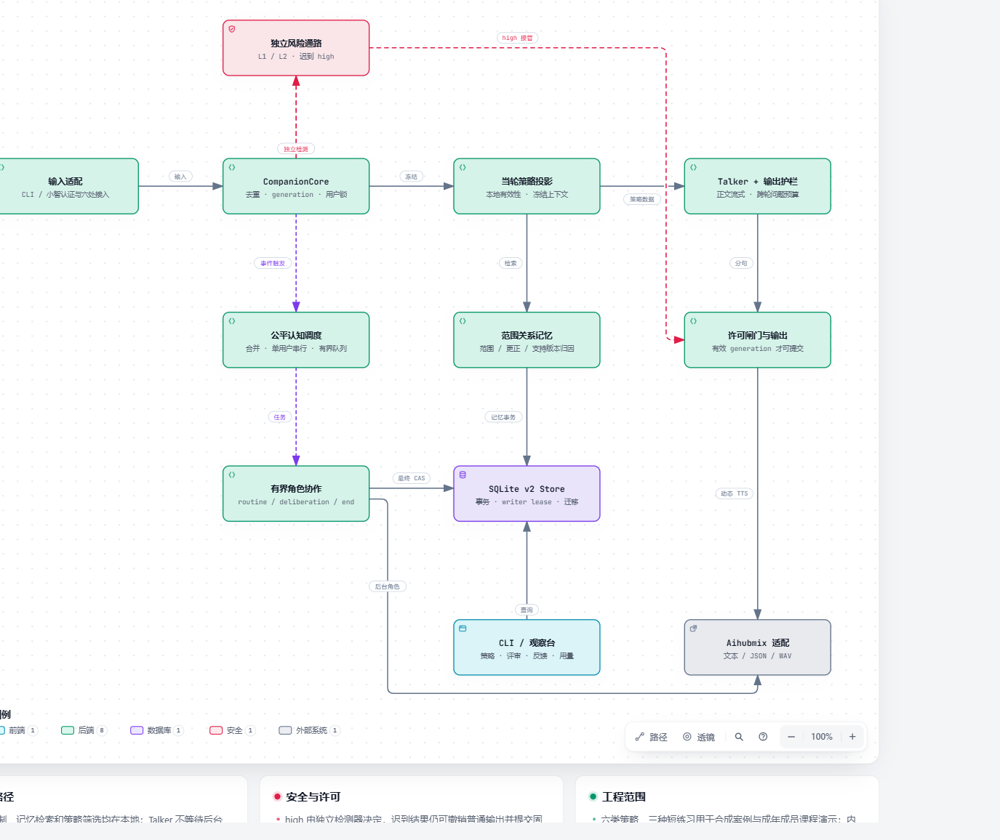

# 情感陪伴玩偶后端

依据 [v2 主规格](companion/docs/ARCHITECTURE_V2.md) 升级的 Python 3.10 模块化后端。默认 development 已接入实时 Talker、后台 Analysis / Planner / 独立 Critic、版本化策略、四类关系记忆、独立风险接管与小智语音流水。

当前内容版本为 `course-1.0`：六类支持策略、三段可中止短练习、固定危机支持文本，已接入默认 development 路径。研究情境是中国大陆高中生日常压力；课程演示仅用合成案例或成年成员扮演。来源核查、自动内容审查、真实回放和音频资源分别验收，课程回执已绑定当前版本，准备本机固定音频后可使用 `--mode demo`。当前升级进度见 [实施状态](companion/docs/autonomous-upgrade/IMPLEMENTATION_STATUS.md)，实测与未达项见 [验证报告](companion/docs/VALIDATION.md)。

## 研究、策略与架构

[在线阅读：项目研究与系统设计说明](https://hhuang999.github.io/companion-doll-backend/research-design/)

新版说明从研究依据展开到六类策略、Multi-agent 协作、长期记忆及验证局限，配有 13 张说明图，支持章节目录、手机阅读与浏览器打印。另附 [Markdown 正文](companion/docs/research-design/PROJECT_RESEARCH_AND_SYSTEM_DESIGN.md) 和 [本地阅读版、图源与核对记录](companion/docs/research-design/README.md)。

[](https://hhuang999.github.io/companion-doll-backend/)

[打开项目展示与交互架构](https://hhuang999.github.io/companion-doll-backend/) · [逐项验收状态](companion/docs/V2_IMPLEMENTATION_STATUS.md) · [运行与迁移手册](companion/docs/V2_OPERATIONS.md)

新版首页以日光场景与原创陪伴形象呈现项目；可切换“只想说说 / 想试办法 / 反馈没帮助”三种合成情境，亲自选择同意或拒绝，并点选实时、协作、安全、记忆四条系统通路。还可筛选六类策略、展开研究依据，并切换P50/P90实测时间轴。演示在浏览器本地运行，不调用在线模型；玩偶图片为AI概念视觉，非已验证设备实拍。[网站设计与验证](docs/PAGES_VALIDATION.md)记录界面检查。

[](https://hhuang999.github.io/companion-doll-backend/)

图集包含五个可交互视图：研究与策略执行闭环、实时与安全通路、有限协作与版本发布、长期关系记忆、小智语音流水。点击节点可追溯到固定实现提交的 GitHub 源码；HTML 下载后也可以独立打开。

[v1 历史图集](https://hhuang999.github.io/companion-doll-backend/index-v1.html) 保留供比较，固定于历史提交 `d24f38f`。默认代码基于 v2，项目站增加研究证据、策略筛选和反馈记忆的解释。

六类支持的来源、适用与排除条件见 [策略设计](companion/docs/autonomous-upgrade/STRATEGY_DESIGN.md)；完整核查见 [16项研究证据](companion/docs/autonomous-upgrade/research/EVIDENCE_REVIEW.md)。短语音步骤是原创改编，不继承完整人工干预的效果。

## 立即运行

首次使用请先按下方“安装到新环境”建立 `.venv`，并配置 `.env`。然后在本目录打开 PowerShell：

```powershell
# 离线文字对话，不调用 API
./scripts/run.ps1 fake

# 使用项目 .env 中的 AIHUBMIXKEY
./scripts/run.ps1 live

# 在另一个终端打开观察台，地址 http://127.0.0.1:8501
./scripts/run.ps1 dashboard
```

命令行支持 `/policy` 查看当前与当轮策略、`/memory` 查询范围记忆、`/jobs` 查看任务及评审、`/state` 查看状态、`/wait` 等待后台分析、`/cry 今天很难过` 模拟哭声、`/emotion SAD 今天很累` 传递情绪、`/end` 模拟无语音结束、`/quit` 退出。输入“怎么办”会先请求许可；明确同意且有合格卡片后才进入行动。异步分析尚未完成时保留同意并等待卡片。

文字入口中的练习默认按虚拟时间输出，使用 `--realtime` 观察停顿；音频播放由小智适配器负责。

```powershell
./scripts/run.ps1 fake --realtime
./scripts/run.ps1 fake --scenario companion/tests/scenarios/08_permission.yaml
```

## 安装到新环境

需要 Python 3.10 和 uv。Windows 已有 uv 时：

```powershell
./scripts/setup.ps1
# 也可明确指定已有 Python 3.10
./scripts/setup.ps1 -Python C:/path/to/python.exe
```

跨平台的等价安装方式：

```sh
uv venv --python 3.10 .venv
uv pip install --python .venv/bin/python -r companion/requirements.lock
uv pip install --python .venv/bin/python --no-deps -e companion
```

Windows 上解释器路径为 `.venv/Scripts/python.exe`。锁文件对应此次 Python 3.10 Windows 验证环境；其他平台请先验证本机依赖。`.env.example` 只有空变量名；将自己的 key 写入 `.env`。进程环境优先于 `.env`。源码、配置和日志不会写入 key。

## 验证

当前离线 **152 passed / 3 online deselected**。预固定17段真实多轮及定点修复均留有证据；最终30次动态语音全部成功，文本首句P50 1.26秒、客户端首包P50 3.61秒。900ms文本首句和常规后台8秒未稳定达到，真机首响交由硬件同学测量。完整分母、失败和语言限制见[验证报告](companion/docs/VALIDATION.md)，现场步骤见[课程展示脚本](companion/docs/autonomous-upgrade/DEMO.md)。

```powershell
# Ruff、格式检查和全部离线 pytest；不访问网络
./scripts/run.ps1 test

# 真实模型与语音检查、120 条风险回归，会消耗 API 额度
.venv/Scripts/python.exe -m pytest companion/tests -m online --basetemp artifacts/pytest-online-manual

# 文字延迟探针；语音30次全尝试另见小智交接包
.venv/Scripts/python.exe -m companion.tools.bench --env-file .env --count 30 --output artifacts/latency.json

# 生成并测量固定音频；部署绑定命令见内容说明
./scripts/run.ps1 audio
```

默认 `pytest` 排除 online 与 hardware。在线测试使用合成文本，不读取实际用户对话。14 个基础剧本在 `companion/tests/scenarios/`；其中 `fixture` 步骤只允许 FakeLLM，五类压力剧本验证流程而不验证研究适用性。时序、取消、过期与恢复由单独的单元测试控制。

## 配置与数据

默认配置位于 `companion/companion/config/`。可复制整个目录后通过 `--config-dir` 指定自己的版本。

| 文件 | 用途 |
| --- | --- |
| `settings.yaml` | 模型、预算、线程池、数据库、时区、TTS |
| `persona.yaml` / `stages.yaml` | 身份介绍、开场、收尾、各阶段及提议模板 |
| `rules.yaml` / `risk_lexicon.yaml` | 确定性规则、输出护栏、第一层风险检测 |
| `cards/*.yaml` / `content_manifest.yaml` | 可执行策略、来源核查、版本摘要与准入回执 |
| `crisis.yaml` | 固定危机话术和审核信息 |
| `exercises/*.yaml` | 练习文本、句后停顿及可选已测量音频 |
| `prompts/*.j2` | Talker、风险及 Analysis / Brief / Planner / Critic / Delta / Memory / End 提示词 |

默认数据库为工作目录下的 `data/companion.db`。CLI 可用 `--db` 指定路径；小智适配器按 `project_root` 解析。固定音频位于 `data/fixed_audio/`；动态语音只在内存和短暂 WAV 文件中处理，转换后删除。数据库、运行音频、`.env`、测试产物和本地解释器均已忽略提交。

v1 数据库会通过一致备份和事务迁移到 v2，重复启动不重复导入；详见 [迁移与回退步骤](companion/docs/V2_OPERATIONS.md)。启动时会恢复未完成会话，将其转为结束分析任务；旧会话不恢复为活动对话。`failed` 的结束分析保留错误记录，检查原因并停服后可显式重试：`python -m companion.tools.retry_end <session_id> --env-file .env --db data/companion.db`。一个数据库由一个后端进程持有；看板通过独立连接读取。

清除一个用户的数据前停止该用户的对话：

```powershell
.venv/Scripts/python.exe -m companion.tools.purge cli-local --db data/companion.db
```

运行中的服务使用 `CompanionCore.purge_user(user_key)`，它会先取消并等待后台任务。数据库包含原话、记忆和风险记录，备份与清理应覆盖 SQLite 主文件及关联 WAL 文件；正常停服后再备份。

## 接入小智

接入包在 [xiaozhi_patch](xiaozhi_patch/README.md)，锁定上游提交 `92337881a7b6553614b47e137a774d02bf40512f`。六处补丁已批准并应用，独立环境、SenseVoice 权重、Opus 编解码和实际 WebSocket 对话链路已完成联调。

```powershell
# 当前工作区直接启动
./scripts/run_xiaozhi.ps1
# 观察小智服务的独立数据库
./scripts/run.ps1 dashboard --db data/xiaozhi.db
# 新机器首次安装（需先安装根目录环境、uv 与 FFmpeg）
./scripts/setup_xiaozhi.ps1
```

默认 WebSocket 地址为 `ws://127.0.0.1:8000/xiaozhi/v1/`。连接需要独立设备 Bearer 凭据；服务端映射 user_key，不能只凭 device-id 读取记忆。完整安装、协议、错误处理和硬件分工见 [小智交接包](companion/docs/XIAOZHI_HANDOFF.md)。

小智适配器通过统一 OutputPort 发送普通语音、固定危机音频与练习计划，具有独立取消入口。服务端的队列排空估计与设备实际播放完成分开记录，设备首响及停止时刻仍须真机采集。

## 代码入口

- `companion/companion/core/api.py`：输入、风险回调、输出、播放回执和会话结束。
- `companion/companion/core/state_machine.py`：阶段、同意对象与行动次数。
- `companion/companion/cognition/`：公平调度、共享预算、独立评议、DeltaGuard 与最终 CAS；`core/validator.py` 保留行动校验。
- `companion/companion/content/`：结构化内容过滤、来源/hash准入、固定音频绑定。
- `companion/companion/memory/`：四类记忆、来源、范围、中文相关性与更正。
- `companion/companion/store/`：SQLite 事务、快照、记忆、跟进与恢复。
- `companion/companion/adapters/`：文字、剧本与小智适配器。
- `companion/companion/dashboard/`：本地观察看板。

实现取舍见 [DECISIONS.md](companion/docs/DECISIONS.md)，课程内容准入与准备见 [内容准备](companion/docs/CONTENT.md)。
