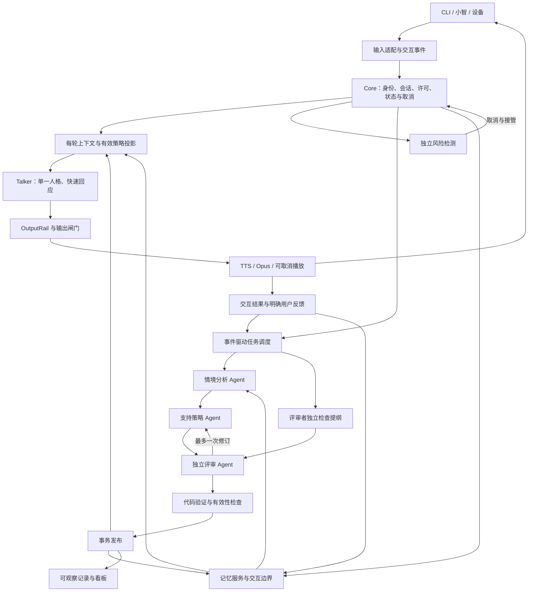

# 情感陪伴玩偶后端 v2：实时交互、多 Agent 协作与长期关系记忆

版本：2.0-design.1 · 日期：2026-11-03（Asia/Singapore）  
状态：已获用户方向授权的开发规格；本文描述目标系统，不表示功能已经实现。  
读者：负责后端、模型调用、小智适配、测试和维护的开发者。  
核对基线：Git `43253fe9719b1f96e41d40948b6a805211dc8adc`。实施时以实际工作区为准，保留后来发生的有效改动。

配套文件：[Codex 完整开发执行 Prompt](CODEX_UPGRADE_V2_PROMPT.md)。

## 1. 目标、范围与文档优先级

### 1.1 本次升级要交付什么

交付一套可以通过 CLI 和现有小智链路运行的完整后端：前台维持单一人格和可打断的快速回应；后台依据交互事件协调情境分析、支持策略规划与独立评审；系统以带证据、有效期和适用范围的策略及记忆维持跨轮次、跨会话的连续性。

研究展示优先，同时保留产品可用性。本次不要求 A/B、消融、多模型排名或强化学习训练。需要的验证是功能、并发、恢复、真实接口、响应质量和端到端性能验收。展示应能从一段对话追踪到触发原因、分析依据、评审意见、最终策略与用户反馈。

本版必须完成：

1. 事件驱动的后台任务调度与有限多 Agent 协作。
2. `SupportPlan`、情境描述、评审结果及每轮实际采用的策略记录。
3. 按产物划分的有效性规则，解决后台分析因普通新轮次全部作废的问题。
4. 带来源、时间、范围及更新关系的长期记忆，含检索和交互边界处理。
5. 用户反馈与播放结果闭环；反馈能改变后续策略和有依据的偏好。
6. SQLite v1→v2 迁移、恢复、清除、故障记录和可重复运行入口。
7. CLI、小智、观察台、提示词、假模型、测试及文档的完整接入。
8. 运行中的语音延迟优化、指标分段、取消隔离和现有六处小智补丁兼容。

### 1.2 保留的工程边界

- Python 3.10+ 模块化单体；一个 SQLite 数据库只由一个 Core 进程管理。观察台可独立查询，已有“标记已处理”窄操作可保留。
- AI 服务继续通过 Aihubmix；密钥由本地 `.env` 的 `AIHUBMIXKEY` 读取。
- 保留 SQLite WAL、代码状态机、不可变 `TurnContext`、版本化发布、独立风险检测和 generation 取消。
- 用户身份仍按一台设备对应一个 `user_key`。设备共用身份系统不属于本版。
- 不引入微服务、消息中间件、向量数据库或通用 Agent 框架作为前置依赖。实现者可因具体需要引入小型依赖，记录理由并更新锁文件。
- 不建设模型训练、在线自主改写提示词、无限讨论或自动生成正式干预内容的系统。

### 1.3 与已有文档的关系

本规格替代 v1.1 中关于单个 Reasoner、统一过期判断和旧核心记忆选择的相应设计；其余要求继续适用。参考：

- [后端设计 v1.1](../../情感陪伴玩偶%20·%20后端技术设计文档%20v1.1.md)
- [实现决定](DECISIONS.md)
- [现有验证记录](VALIDATION.md)
- [内容与审核说明](CONTENT.md)

状态、许可、风险、人格边界、正式内容审核门槛不因引入 Agent 而降低。没有正式卡片或审核内容时，应完成对应引擎和 development 场景；`demo` 继续拒绝不完整的正式内容。六处小智补丁已获批准，无需重新询问该范围。

本文的“必须”是验收要求；“默认”是可在实施中根据测量调整的初始参数，调整需说明理由；目录布局是推荐实现结构，允许等价且清楚的实现。

## 2. 当前实现与具体升级点

| 当前入口 | 已有能力 | v2 工作 |
| --- | --- | --- |
| `companion/companion/core/api.py` | 输入、状态、风险、输出、单个 `_run_reasoner` | 保留 Core 权威，提取后台编排，接入事件、策略与记忆服务 |
| `core/reasoner.py` | 每用户串行、待运行任务合并、结束任务优先 | 按任务类型和优先级调度，增加预算、取消及持久化状态 |
| `core/models.py` | Snapshot、ReasonerOutput、TurnContext、PlaybackPlan | 增加 v2 契约；区分支持策略和播放计划 |
| `core/state_machine.py` | 许可、行动、练习、退出和阶段转移 | 将合格 SupportPlan 建议映射到已有规则，保留代码最终裁定 |
| `core/validator.py` | V1–V8、来源、卡片、状态检查 | 保留有效规则，增加策略、评审、记忆范围和版本检查 |
| `core/talker.py`、`config/prompts/talker.j2` | 流式分句、最多三句和一个问题 | 接收每轮冻结的策略与结构化记忆投影 |
| `store/db.py`、`store/schema.sql` | v1 的 12 张表、事务、结束恢复 | 正式迁移、新表、统一查询和清除 |
| `llm/client.py`、`llm/fake.py` | 流式及 JSON 接口、SDK 无自动重试 | 调用预算、用量元数据、角色路由、结构化失败模拟 |
| `adapters/xiaozhi/output.py` | WAV→Opus、缓存、独立取消 | 有界预取/流水处理、过期丢弃、准确的播放证据 |
| `dashboard/app.py` | 会话、风险、分析和统计 | 协作过程、有效性、记忆来源与反馈可视化 |

两项已确认的实现约束：

1. `SessionState.active_plan_id` 目前指向练习的输出/播放计划。新增支持策略使用 `active_support_plan_id`，不得混用。
2. 当前 Store 只接受数据库版本 0/1，并执行含 `PRAGMA user_version = 1` 的脚本。必须先改为迁移驱动的启动，不能在 v2 启动时继续执行旧脚本覆盖版本。

当前性能证据：30 轮文本首句中位数约 1398.5 ms，P90 约 1828 ms；9 次普通后台分析中位数约 10 s；单次本机动态音频首包约 4016 ms。这些是 v1 的记录，不是 v2 的承诺，也不是设备首响证明。

## 3. 系统结构与权威边界



### 3.1 三个通路

| 通路 | 运行时职责 | 依赖限制 |
| --- | --- | --- |
| 实时交互 | 当前输入、显式控制信号、策略筛选、Talker、输出 | 不等待后台分析、评审、记忆提取或补充核对 |
| 后台认知 | 情境、策略、评审、记忆、会话整理 | 有调用数、并发、输出量、总时限和过期检查 |
| 独立安全 | 每次真实输入的风险检测、迟到 high、固定危机播放 | 不进入协作投票；不等待后台槽位或 TTS 预取 |

### 3.2 最终权威

- Core 独占会话状态修改和策略生效决策；模型没有数据库写权限和播放权限。
- `StateMachine` 决定阶段与行动转移；`PendingOffer` 决定同意是否有效。
- RiskDetector 的接管不受其他 Agent 否决。分析 Agent 可以提出需要风险复查的线索，但不能直接写 `high` 或解除危机模式。
- Store 执行事务、用户隔离、版本 CAS 与证据引用检查。
- Talker 只表达已给定的策略和允许行动，不根据输出标签产生新授权。
- 所有新角色均通过有限函数接口运行，不允许自动创建更多角色、调用任意工具或自行延长讨论。

## 4. 开发用语与共同数据规则

| 名称 | 定义 |
| --- | --- |
| `SituationAssessment` | 带依据的情境理解，区分事实、假设、未知和用户表达的需要 |
| `SupportPlan` | 跨若干轮可使用的支持策略；不等于某句回复，也不等于 PlaybackPlan |
| `TurnPolicyFrame` | 本轮实际冻结的策略、交互边界、行动权限与记忆投影 |
| `InteractionEvent` | 用户控制、反馈或系统执行结果；由 Core 验证后持久化 |
| `CognitiveJob` | 一次有界后台任务，包括所处理的证据范围与预算 |
| `ReviewBrief` | 评审者未见候选策略前形成的独立检查提纲 |
| `ReviewResult` | 针对确定候选版本的结构化评审结果 |
| `MemoryItem` | 有来源、时间、范围、状态和更新关系的长期记录 |
| `policy_revision` | 影响策略适用性的控制/边界修订号；不随每次普通输入递增 |
| `memory_revision` | 用户记忆提交版本；用于并发校验和检索失效 |
| `boundary_revision` | 用户级交互边界版本；覆盖新增边界对同用户其他活动会话的影响 |
| `checked_through_user_index` | 该策略已核对到的用户轮次序号 |

所有契约使用 Pydantic，边界模型 `extra="forbid"`，不可变产物使用 frozen 模型。持久化时间用 UTC ISO 8601；日期、今天、临时边界到期按项目配置的 `runtime.timezone` 解释。运行中时限使用 monotonic，重启后从持久化 UTC 时刻计算剩余有效期，不持久化 monotonic 值。

所有模型输出中的 ID 都是声明，必须回查：属于当前 user、来源确实存在、类型正确、位于允许的证据范围。跨会话引用只允许同一用户，且仅限已检索并提供给该次调用的记忆或历史来源。不能用另一 Agent 的陈述代替用户原话。

### 4.1 EvidenceRef

字段：`kind: user_turn|memory|interaction_event`，`id`，`claim`（简短依据说明），可选 `quote`。`quote` 若提供，需能与指定源文本匹配；应用层不要求模型提供长推理链。来源类型用于区分“用户明确说过”和“系统观察到执行结果”。

来源校验只能证明引用存在，不能机械证明语义正确。评审与响应质量检查补充语义检查，日志据实记录这一区别。

### 4.2 输入事件与语义线索

原有 `InputKind=user|wake|idle_end` 保持兼容。`InteractionEvent` 的建议字段：

| 字段 | 类型／说明 |
| --- | --- |
| event_id / idempotency_key | 稳定唯一 ID；同一输入或播放回调重复到达不能产生重复作用 |
| user_key / session_id | 身份边界 |
| turn_id / output_id / offer_id / support_plan_id | 按事件类型填写；验证关联归属 |
| event_type | `user_correction`、`support_refused`、`boundary_requested`、`topic_changed`、`explicit_feedback`、`offer_accepted`、`offer_withdrawn`、`playback_started/completed/cancelled/failed`、`exercise_completed/interrupted`、`session_ended` 等 |
| origin | `user_explicit`、`deterministic_rule`、`semantic_candidate`、`server_playback`、`device_ack` |
| payload / evidence | 有限长度的类型化数据和来源 |
| occurred_at / recorded_at | 事件时刻与入库时刻 |

`semantic_candidate` 不能伪装成确定的用户同意、明确积极反馈或真实设备播放确认。语义分析的提案须经 Core 处理后才产生状态变化；含糊的“算了”“还行”保留不确定性。

### 4.3 SituationAssessment

保留现有 Assessment 中压力类型、路径线索等可用字段，新增：

- `facts[]`：用户陈述与来源。
- `hypotheses[]`：可能的解释及支持/冲突证据，不写成诊断或固定人格。
- `expressed_need: listen|clarify|comfort|solve|quiet|unknown`。
- `open_questions[]`：最多 2 项，区分需要问用户与无需立即询问的未知。
- `topic_summary`、`topic_change_proposal`、`boundary_candidates[]`。
- `memory_candidates[]`：仅作为待校验候选，不直接写库。
- `risk_review_requested`：可触发独立检查，不改变安全状态。

事实、假设和未知必须独立存放；模型自报置信度可记录，但不作为许可、风险或任务触发的唯一标准。

## 5. SupportPlan 与每轮实际策略

### 5.1 SupportPlan 契约

由模型生成内容字段，由程序分配 ID、版本、时间、来源截止点和审查元数据。模型不能自签 `approved`。

| 字段 | 类型与规则 |
| --- | --- |
| plan_id / version / schema_version | 程序分配；同一计划修订有明确候选版本；发布版本单调 |
| user_key / session_id / topic_revision | 绑定用户、会话与话题 |
| source_turn_id / source_user_index | 分析截止输入；不是后台完成时的最新轮次 |
| checked_through_user_index | 已核对新增输入的最远位置 |
| policy_revision / base_plan_version | 发布与使用时的控制版本和 CAS 基线 |
| boundary_revision | 任务读取的用户级边界版本；提交时检查最新边界 |
| memory_dependency_versions | 实际使用的记忆项及版本；不能只记录总版本 |
| objective | `listen|clarify|comfort|reflect|provide_information|invite_action|invite_exercise|close|quiet` |
| understanding | 简短理解，引用已校验情境依据 |
| evidence | 支持策略选择的 EvidenceRef 列表；非空且与当前用户有关 |
| response_guidance | 表达方式，至多 3 条 |
| open_question | 至多一个建议澄清点；不是必须每轮提问 |
| candidate_actions | 合格卡片/练习 ID、依据、许可要求；只表示候选 |
| avoid | 类型化暂缓行为：`no_advice`、`no_repeat_offer`、`no_topic_probe`、`no_memory_mention` 等，可携带对象 |
| observation_targets | 下一轮需要观察的明确反馈，至多 3 项 |
| valid_until / max_user_turn_delta | 默认 120 s / 4 个用户轮次，任一到期即失效 |
| review_status / review_run_id | `not_required|approved|rejected|incomplete` 与关联记录 |
| status | `active|superseded|invalidated|expired`；可由字段派生，但查询必须一致 |

默认有效期是初始工程值，允许根据实测调整。修订任务或重复读取不能无条件刷新年龄：新候选必须实际纳入新证据，才可更新 source。

### 5.2 轻量策略与完整策略的权限

- 常规分析产生的轻量策略只允许 `listen/clarify/comfort/reflect/quiet`；可标 `not_required`，不声称经过独立评审。
- `provide_information/invite_action/invite_exercise` 及因纠正、拒绝产生的策略修复，必须走完整评议，评审通过后才成为对应候选。
- 无有效计划时使用当前输入、当前阶段、已确认交互边界及安全的倾听/澄清默认策略；不等待 Agent。
- 现有用户主动求助的确定性许可流程保留。Core 可先询问许可，但卡片仍须满足合格性、来源和适用性；无合格卡时进入现有有期限等待，不能凭同意自动选卡。
- 卡片白名单、每会话使用限制、强情绪排除、一次行动一张卡及练习 90 s 上限继续由代码检查。

### 5.3 TurnPolicyFrame

在构造 TurnContext 时冻结：`effective_support_plan_id/version`、`objective`、`response_guidance`、`active_boundaries`、`allowed_action_ids`、`memory_projection`、`selection_reason`、`checked_through_user_index`。支持策略引用使用新字段，保留原练习 `active_plan_id`。

优先级固定为：危机/关闭规则 → 当前用户显式控制与有效边界 → 有效许可和当前行动状态 → SupportPlan → 人格与表达风格。策略建议不能覆盖前面三层。

Talker 输入包括当前原话；历史策略中的用户推测和记忆作为数据提供，不作为 system 指令拼接。结构化提示词明确内容边界，防止引用文本提升为控制命令。

旧计划尚未核对当前新输入时，仅可借用通用的倾听/表达方式；不得据此新增行动邀请、改变阶段或主动提起旧敏感话题。当前已被用户明确同意的行动仍按现有状态机运行，遇到拒绝、纠正、换题、危机或许可撤回立即退出。

### 5.4 与现有状态机和 Snapshot 的衔接

SupportPlan 是支持方向，Stage 是代码控制的交互阶段，两者不能一一自动映射：

| objective | 可向状态机提出的建议 | 必须保留的条件 |
| --- | --- | --- |
| listen / clarify / reflect | explore 或保持当前阶段 | 当前用户要求静默时不能强制追问 |
| comfort | comfort 或保持 | 不自动启动练习或行动 |
| provide_information | 当前合法非行动阶段表达 | 不借信息说明绕过具体行动的许可 |
| invite_action / invite_exercise | 征求许可或登记邀请候选 | Core 决定是否能邀请；播放后激活；明确同意后才执行 |
| close / quiet | 合法 closing / quiet 转移 | 当前用户控制优先，保留收尾轮次上限 |

同一个时刻只能有一个后台策略发布权威。切换 v2 后，不得让旧 `_run_reasoner` 和新 orchestrator 同时写策略、记忆或阶段提案。可保留旧入口为调用适配层，实际转发到 v2。

Snapshot 可作为有效 SupportPlan 与 MemoryBundle 的兼容投影，供现有状态机读取；应携带来源 plan_id/version，统一生成 allowed_cards、preferred_card、assessment 等字段，不形成第二份独立可变策略。原测试与调用方按这一投影迁移，卡片仍执行原 Validator 的适用性和使用次数检查。

### 5.5 输出示例（业务内容示意）

```json
{
  "objective": "listen",
  "understanding": "用户明确拒绝时间管理建议，希望自己的感受被理解。",
  "evidence": [{"kind": "user_turn", "id": 42, "claim": "拒绝再次获得时间管理建议"}],
  "response_guidance": ["承接用户被忽略的感受", "允许继续倾诉，不急于提出办法"],
  "open_question": null,
  "candidate_actions": [],
  "avoid": [{"kind": "no_advice", "target": "time_management", "scope": "topic"}],
  "observation_targets": ["用户是否主动提出想要具体帮助"]
}
```

这是候选内容投影，不是包含全部服务端字段的数据库对象。测试中 turn 42 必须由测试创建，不能假定任意环境都有该来源。

## 6. 多 Agent 协作协议

### 6.1 三个角色与受限输入

| 角色 | 输入 | 输出 | 不拥有的权力 |
| --- | --- | --- | --- |
| 情境分析 | 有限对话、有效记忆、当前状态和边界 | SituationAssessment | 批准行动、解除风险、写库 |
| 支持策略 | 已校验情境、可用卡片摘要、边界、最近有效策略和反馈 | SupportPlan 候选 | 创造正式卡片、授予许可、发声 |
| 独立评审 | 原始证据、独立 Brief、情境、确切候选版本、规则 | ReviewResult | 修改用户事实、直接发布、投票否决风险 |

同一模型可以承担不同角色，但调用上下文必须隔离；“不同提示词”不证明错误独立。默认使用当前已验证模型，不因角色数量自动引入新供应商。

### 6.2 两类策略任务

**常规任务 `routine`：** Analysis → 本地情境校验 → Planner → 策略校验 → 发布非行动策略。最多两次业务调用；不能在常规路径偷偷附加行动权限。

**完整任务 `deliberation`：**

1. 冻结同一份输入证据。Analysis 与评审者的 ReviewBrief 可以并行。
2. Brief 仅看用户原始证据、状态、边界与既往反馈，不看分析 Agent 的结论或候选策略；最多 3 条关注点和反证。
3. Planner 基于已校验 Analysis 生成候选 V1。
4. Critic 读取 Brief、原始证据和候选 V1，输出结构化评审。
5. 若 `revise`，允许 Planner 修订一次为 V2，Critic 对 V2 复核一次；不得重复循环。
6. `approve` 后进入代码校验与发布。若 `reject/insufficient_information`、预算耗尽或修订仍不通过，记录结果并保留仍有效旧策略；否则使用倾听/澄清默认。

完整无修订任务为 4 次业务调用，有修订为 6 次。Brief 与 Analysis 是并行机会，不是新 Agent 数量。不得因 Brief 失败而把未经独立评议的结果标为 approved。

### 6.3 ReviewResult

字段：`candidate_id/version`、`verdict: approve|revise|reject|insufficient_information`、`issues[]`、`required_changes[]`、`unresolved_questions[]`。每条 issue 包含 `code`、`severity`、`evidence_refs`、简短说明。

最少覆盖：事实不支持、用户意图偏离、拒绝未尊重、许可不足、记忆冲突、建议过早、重复建议、人格/关系边界、卡片不适用。无依据的同意不能替代代码校验。

只存简短决策依据和结构化检查结果，不要求或保存模型的私有长思维过程。模型原始输出如需调试，仅保存在本地受忽略的开发产物中。

### 6.4 失败与重试

- JSON/schema 失败可在同一任务预算内修复一次，整个任务共享该次数，不是每个角色各自重试一次。
- 事实无依据、评审拒绝、策略不合格不是 JSON 格式错误，不能无限重问以获得通过。
- 网络错误/429 记录为明确失败或降级；不在同一任务中无界重试。后续由新事件或显式重试创建新任务。
- 模型响应可能超时后仍到达；取消与发布校验必须在返回后执行，结果不能重新激活已取消工作。
- 时间预算优先于完整调用流程。已经过期不继续调用下一个角色。

## 7. 事件驱动调度、预算与资源隔离

### 7.1 触发规则

| 事件 | 立即生效的 Core 行为 | 后台任务 |
| --- | --- | --- |
| 普通新输入 | 生成新 generation、冻结本轮上下文 | 无任务，或每 4 用户轮 routine |
| 明确换题 | 话题修订递增、旧提议和策略失效 | routine；涉及行动时 deliberation |
| 用户纠正/拒绝 | 当前行动/提议按规则退出，policy_revision 递增，限制重复行为 | 高优先级 deliberation |
| 明确求助/缺少合格卡 | 现有许可流程与有期限等待 | deliberation |
| 边界请求/记忆冲突 | 建立临时保护、使依赖信息失效 | deliberation + 合并的 memory 任务 |
| 策略重复失效 | 不自动判定情绪恶化 | deliberation |
| 明确有用/无用反馈 | 记录可归因反馈，限制不适当重复 | 必要时 deliberation，合并 memory |
| Cry/情绪标签 | 作为信号，维持现有规则 | 按事件合并；不是诊断证据 |
| risk watch | 保留风险记录和当前保护 | 合并 deliberation，不重复发起风险链 |
| risk high | 立即独立接管，取消当前普通任务 | 不运行普通策略协作 |
| 会话结束 | lifecycle=ending，停止普通输出 | durable end_consolidation |

“重复失效”初始定义为同一策略/同一可归因提议在最近 4 用户轮中收到至少 2 个明确拒绝、纠正或负面反馈；一次明确拒绝已经会触发修复。没有回应、沉默或播放结束不算失败或成功。

### 7.2 队列与公平性

- 同一用户最多一个活动认知任务，任务内部可并行 Analysis/Brief。不同用户公平轮转。
- 同一用户/会话/任务类别的待运行任务合并触发原因，source 更新到最新证据；较强任务覆盖尚未开始的 routine。
- 优先级：结束整理 > 用户纠正/拒绝/边界变化 > 明确求助/缺卡 > 普通周期 > 独立记忆整理。风险始终在队列之外。
- 结束时取消该会话的普通任务、持久化结束任务；不得复活旧会话或覆盖新会话计划。
- 单个用户最多保留 routine/deliberation 合并任务 1 个、memory 合并任务 1 个。结束任务不可因队列满而丢失；全局排队上限和溢出状态必须配置并可观察。
- 普通队列等待超过默认 30 s 时，不执行旧证据任务：合并为最新任务或记录 expired。结束任务保留可恢复状态。
- 不得在同一个已耗尽的线程池里由父任务同步等待子任务，造成饥饿死锁。编排线程与模型调用槽位分开，或采用能证明无此问题的异步实现。

普通全局待运行上限默认 256。达到上限先合并同用户已有项；仍无空间则拒绝新增普通任务并记录 `queue_full`，前台继续运行。结束任务先落入 durable end_tasks，再按有界执行槽位消费，持久化待办不等于无限内存队列。对同优先级按最早等待时间排序，周期任务等待过久可进行一级优先级提升；不能提升到风险通路。

任务生命周期：`queued → running → completed|partial|rejected|failed|timed_out|cancelled|superseded|interrupted`；排队阶段还可成为 `superseded|cancelled|expired`。完成状态互斥，终态不因迟到回调重新变为 running。`completed` 表示该类任务的目标产物已按要求提交；`partial` 表示只有部分产物提交；没有产物且保留旧策略不记为 completed。重试产生新的执行记录并关联原任务，保留旧失败证据。

有重要控制变化时取消尚在运行的旧任务；若底层同步 HTTP 请求不能立即中断，槽位仍计算为占用直到真正退出，不伪造已释放并不断追加线程。关闭时到达 shutdown_grace 后保留 durable 任务，说明仍在途请求的处理方式；下一次启动按恢复规则收敛。

### 7.3 初始预算

这些是配置初值和上限，不是已测性能结果。新增配置统一放在现有 settings 下，启动时验证；不要维护两个冲突的 reasoner timeout。

| 类型 | 活动总时限 | 业务调用 | 最大总调用数 | 累计输出 token 上限 |
| --- | ---: | ---: | ---: | ---: |
| routine | 20 s | 2 | 4 | 2400 |
| deliberation | 20 s | 4，修订后 6 | 8 | 6000 |
| memory | 20 s | 1 | 2 | 1800 |
| end_consolidation | 20 s | 1 | 2 | 2400 |

总调用数包括格式修复和最多一次新增证据核对；超出即终止，不“借用”下一任务预算。累计输入+输出 token 初始上限 routine 16000、deliberation 32000、memory/end 16000。启动请求前估算并预留本次上限，返回后记录 provider usage；未返回用量标为 estimated/unknown，不记为零。使用可说明的保守估算，不能把字符数冒充精确 token。

每角色建议最大输出：Analysis 900、Brief 350、Planner 900、Critic 650、DeltaGuard 350。预留超时给仍需运行的步骤；若剩余时限不足，不开始没有机会完成的调用。短上下文和有限候选是第一优先的速度优化。

后台默认最多 2 个并发模型请求；风险、Talker、TTS 使用独立本地资源，后台请求不能占满其连接池或执行器。共享供应商限流仍可能造成竞争，必须记录 429、超时和并发数；本地隔离不等于上游 QoS 保证。

现有 qwen-flash 用于 Talker/Risk，并作为 Analysis/Brief/Critic 的初始配置；qwen-plus 用于 Planner 和结束整理。保持角色级模型配置。开发者应完成真实 API 能力探针后采用可用配置，并保留相应记录；不得声称这些模型天然满足新预算。

## 8. 按产物划分的有效性与事务发布

### 8.1 修订号

- `generation`：输出代次，普通新输入也改变，用于取消。
- `state_revision`：保留原状态记录语义，不再用于一刀切废弃所有后台产物。
- `topic_revision`：明确或经校验接受的话题改变时递增。
- `policy_revision`：拒绝、纠正、静默请求、许可撤回、行动开始/结束、危机变化、有效交互边界改变时递增。普通延续性输入不递增。
- `memory_revision`：每用户记忆事务递增；每个记忆项也有独立版本。
- `boundary_revision`：同用户交互边界新增、更正、撤销时递增；到期仍由每次读取的时间过滤处理。
- `support_plan_version`：每会话已发布策略版本。

模型提出的 topic/boundary 变化先成为候选。Core 按来源截止点和当前证据接受后，统一更新修订号、失效策略和相关提议。候选本身不能预先写新 revision。

### 8.2 四类产物

| 产物 | 发布与使用条件 |
| --- | --- |
| 当轮回复/播放 | session active、generation 精确匹配、风险与输出闸门允许 |
| SupportPlan | 同用户会话、mode=normal、topic/policy 未改变、未过期、基线计划版本未被替换、依赖记忆未冲突、边界版本通过检查、新输入已核对或仅作受限非行动投影 |
| 记忆候选 | 来源同用户且存在、范围有效、无后续更正覆盖、受影响记忆版本匹配；不要求 latest_turn 完全相等 |
| 结束总结 | 绑定该次结束的 final_turn_id 和会话；不修改新会话策略，不覆盖较新的记忆更正 |

### 8.3 新输入出现后的处理

若任务完成时有 source 之后的新输入，不能直接认定“话题没变”。采用以下有界处理：

1. Core 已识别到拒绝、纠正、换题、边界改变、危机或生命周期变化：相关策略直接失效。
2. 其他新增输入不超过默认 4 个用户轮、未越过计划年龄上限：允许一次异步 `DeltaGuard`，仅核对候选及其依据与新增原话是否兼容。输出 `compatible|invalidate|uncertain` 和来源，不生成新的长分析。
3. compatible 只能把 `checked_through_user_index` 推进到实际核对的截止点。它不能修改策略语义、授予同意或延长原始有效期。
4. invalidate/uncertain/超时：不发布待处理策略；保留仍有效的旧策略或默认倾听。合并最新任务，避免同一输入重复重算。
5. DeltaGuard 返回期间又有新输入：最终 CAS 检查失败，任务标 superseded，不再循环追加 Guard。

已经发布的计划也遵循相同使用规则：新的未核对输入只允许通用非行动投影；需要跨轮采用行动候选或主动记忆提及时，安排异步核对，当前轮不等待。普通短轮次不能无限延长旧计划。

### 8.4 发布顺序

```text
读取证据与版本，释放锁
→ 在任务 deadline 内运行 Agent / Guard
→ 验证 schema、来源、卡片、边界及评审对应的候选版本
→ 获取该用户提交锁，再获取会话锁
→ 读取最新控制状态、依赖记忆版本和计划版本
→ BEGIN IMMEDIATE，CAS 校验，写入产物与终态记录
→ COMMIT
→ 更新内存中的不可变引用
→ 释放锁
```

所有需要多个锁的写路径统一顺序：用户提交锁 → 会话锁 → Store 写事务。registry 锁不跨网络和上述长操作持有；读路径避免反向取锁。网络/TTS/模型调用不在会话锁或数据库事务内执行。

同一任务的策略与记忆可以有不同适用结论：策略过期时，合格记忆仍可单独提交。运行记录保存每个产物的 accepted/rejected 原因，任务可标 `partial`，不能把部分提交伪装成全部成功。数据库错误时对应提交单元整体回滚。

计划评审通过但发布时被拒绝，应记录两个独立事实：评审结果与最终发布结果。新计划不改变已经冻结的 TurnContext，也不自行插播语音；下一个合法交互节点采用。

边界新增时，旧计划可能根本没有引用该 memory_id，因此只比较 memory_dependency_versions 不够。提交与每轮投影还必须读取最新 boundary_revision 和有效边界；版本改变则使相关策略失效或按最新边界收紧，不能仅凭“原依赖未修改”通过。此规则同时覆盖同一用户在另一个活动会话中的修改。

输入引起的控制事件、policy_revision、提议撤回和会话状态应在同一写入单元内持久化。数据库提交失败不发布新的可用内存状态；为防止旧音频继续播放，取消动作可先执行，失败后报告错误并进入受控状态，不能回退到继续旧输出。事务提交后刷新内存失败时，从数据库重载或显式停止该会话，不让两套状态继续分叉。

## 9. 长期关系记忆与边界服务

### 9.1 四类记录

| 类型 | 内容 | 默认限制 |
| --- | --- | --- |
| fact_preference | 称呼、兴趣、明确表达的回应偏好 | 事实与推测分开；长期偏好需明确长期表述或进一步确认 |
| episodic_event | 事件、进展、时间、相关人物 | 保留来源与事件时间；更正不覆盖原证据 |
| interaction_boundary | 不希望被问/被建议的内容与范围 | 优先于普通检索；不依赖相似度才能取出 |
| support_experience | 曾尝试的支持、明确反馈及执行结果 | 区分完成、拒绝、有帮助；不从沉默推断效果 |

`MemoryItem` 至少包含：`memory_id`、`user_key`、`kind`、`key`、`value`、`epistemic_status: stated|observed|hypothesized|legacy_unverified`、`source_refs`、`event_time`、`recorded_at`、`scope`、`scope_ref`、`valid_from`、`expires_at`、`status`、`version`、`supersedes_id`、`sensitivity`、`mention_policy`。

scope 为 `turn|topic|session|until_time|persistent`。topic/session 记录绑定对应 ID；跨会话不把上次 topic 编号误认作当前话题。提取不出范围时使用 session，必要时澄清；不自动升级为永久偏好。

### 9.2 边界请求

- “今天别问论文”：`until_time`，按配置时区取当日本地日末转 UTC。
- “这次别给建议”：session 或当前 topic，结合原话选择更窄且有依据的范围。
- “以后不要主动问论文”：persistent、topic target=论文、mention_policy=avoid_proactive；用户主动聊该话题不自动撤销该边界。
- “刚才说错了”：先让引用该信息的策略/记忆退出主动使用，澄清后提交更正。

显式边界匹配应复用并扩展现有规则；匹配不确定时建立本会话临时保护并触发分析，不把规则覆盖范围宣称为所有自然语言。没有立刻提取出 target 时，临时暂停该话题的主动建议/追问，避免等待后台期间重复踩到用户明确拒绝。

更长期边界与较窄允许例外可以共存。例如长期“不主动问论文”，今天用户主动说“可以问我进度”：允许当前范围内例外，原长期记录不删除。解析顺序：安全硬约束 → 最新明确的适用范围内例外 → 其他有效边界。只有用户明确撤销长期边界才全局撤销。

### 9.3 写入与更正

候选提取 → 来源/范围/语义评审 → 去重与冲突检查 → 事务提交。对同一 key，保留新旧记录和 supersedes 关系；历史记录不在普通检索中作为当前事实返回。

对 source 之后出现的相关更正，拒绝旧候选。无关新输入不妨碍写入。同一任务重试使用稳定候选 ID/规范化内容加来源的幂等键，不能因重试重复生成事件或偏好。批量写入失败整体回滚；不同产物拆分提交时按第 8 节分别记录。

hypothesized 只进入短期情境，不自动成为长期用户事实。单次“这次有帮助”可记录支持经历，不能自动写成“用户总是喜欢这个方法”。

### 9.4 检索与记忆投影

先按 user、有效范围、状态、时效过滤；强制取出当前适用边界，再选事实偏好、相关事件、跟进及支持经历。初版使用 SQLite 索引和可解释的领域词/字符检索；中文查询须有实际案例验证，不能假设默认英文分词足够。

排序至少考虑：当前话题相关性、事件新近性、明确反馈、重要性、是否已在近期提起。记忆命中后再次执行 mention_policy。对边界之外的数据超预算，依次删低优先项；边界以紧凑代码字段保留，不以截断 JSON 字符串的方式压缩。

默认 Talker 的策略+记忆附加上下文预算为 1200 token，使用完整有效 JSON/模板投影；替代当前 `model_dump_json()[:450]` 截断做法。任何缓存都按 user、相关 revision、话题及到期时间失效，不能跨用户复用。

旧 CoreMemory 的读取接口可保留为投影兼容层。事实/事件的权威来源迁到新记忆表；跟进调度仍由原 followups 管理，记忆引用其 ID，不建立两个独立调度器。

## 10. 交互反馈与归因

反馈必须绑定可说明的对象：具体 output、offer、action 或 SupportPlan。用户笼统说“挺好的”且对象不明时记录 `unattributed`，不自动修改方法偏好。

| 观察 | 可记录的结论 | 不能推断的结论 |
| --- | --- | --- |
| 服务端完成发送 | 输出发送完成估计 | 设备确实播完、用户听到、情绪改善 |
| 用户中止练习 | exercise_interrupted | 练习无效或用户变得更糟 |
| 用户说“别再这么建议” | 当前方法被明确拒绝 | 所有建议永远都不接受 |
| 用户说“刚才这样问有帮助” | 指定交互得到明确积极反馈 | 已建立长期疗效 |
| 用户沉默 | 缺少反馈 | 默认满意 |

重复回调依靠幂等键去重。播放 completed 后迟到的相同 completed 不再计数；cancelled 的旧 generation 不能重新激活提议。不同终态冲突按原始顺序和输出生命周期判断并记录异常。

负面反馈优先进入下一轮策略限制；积极反馈用于排序与后续选择建议，不自动扩大许可。观察台展示的是可观测交互结果，不给用户计算“心理健康分”或宣称治疗成效。

## 11. SQLite v2、恢复与数据清除

### 11.1 新增存储

保留原 12 张表及历史可读性，建议新增：

| 表 | 关键列与约束 |
| --- | --- |
| cognitive_jobs | job_id PK，user/session、kind、triggers、source、版本、priority、budget、status、attempt、queued/started/finished_at、error；逻辑幂等键 |
| agent_runs | run_id PK，job FK、role、attempt、model、prompt_version、candidate_version、usage、duration、status、结构化结果/简短理由 |
| support_plans | plan_id + version，user/session/topic/policy、source/checked_through、review_run_id、valid_until、status、data；发布版本唯一 |
| interaction_events | event_id PK，idempotency_key UNIQUE、user/session、对象引用、type/origin、payload、时间 |
| memory_items | memory_id PK，user、kind/key、scope/ref、时间、status/version、supersedes_id、epistemic_status、value、mention_policy |
| memory_sources | memory_id + source_type + source_id 唯一；来源类型关联由代码验证 |
| user_revisions | user_key PK、memory_revision、boundary_revision；用于提交和缓存一致性 |

至少建立：jobs(status,priority,queued_at)、plans(session_id,status,version)、events(user_key,session_id,turn_id)、memory(user_key,status,kind,key)、memory(user_key,scope,expires_at) 索引。具体列类型、CHECK 和外键由实现确定，JSON 需有 schema_version 和本地验证。

常规任务持久化用于可观察与恢复判定；重启不盲目继续一半的模型讨论。结束任务仍以现有 end_tasks 为业务恢复权威，关联 cognitive_jobs 作为某次执行记录；不得并行运行两个结束消费者。reasoner_runs 保留 v1 历史，新执行写 agent_runs/jobs，观察台统一展示。

### 11.2 迁移规则

1. 修改 Store 启动为版本分发；空库可依次初始化 v1 后迁移 v2，或等价创建 v2，但结果必须一致。
2. 迁移前拒绝其他 Core 同时写入；用 SQLite backup API 创建一致备份，不能在 WAL 活跃时只复制主 db 文件。
3. v1→v2 在事务中创建新结构、导入记忆、写入版本；失败完整回滚并保留可诊断错误。
4. 旧 profile/events 按稳定旧主键生成迁移映射，保留来源；不能核验来源的项标 legacy_unverified，不作为已确认边界或主动敏感提及依据。
5. 原 followups 保留，已完成和已预留状态不重复激活。旧 sessions/state 缺少新增字段时安全初始化，旧 PlaybackPlan 语义不变。
6. v2 库再次启动不重复导入、不重复加表、不退回 v1。遇到更高未知版本 fail fast。
7. 不承诺自动 down migration。回退需要停止服务并恢复一致备份；明确恢复后会丢失备份之后的写入。
8. 更新 package-data，确保迁移 SQL/资源进入 wheel。必须用安装后的包验证空库初始化与 v1 升级。

### 11.3 崩溃与恢复

进程启动将旧 running 普通任务标 interrupted；未结束的旧会话按现有恢复语义进入 ending。其旧策略不得在新连接中继续生效。合格长期记忆保留。

end_tasks 的 pending 与中断任务可以恢复执行；明确 failed 仍通过现有显式 retry 流程重试，attempt_count 增加。结束提取绑定固定 final_turn_id，重复执行不能重复记忆或跟进。跨会话新更正优先于旧会话迟到结束结果。

### 11.4 清除用户数据

清除顺序：注册 purging 阻止新任务 → 递增/撤销有效执行代次并取消输出 → 取消排队任务并等待有界在途回调 → 同一事务删除该用户的所有新旧表记录 → 清理该用户缓存 → 解除运行时引用。

用户提交锁与 purging 屏障覆盖新表。已发出的模型响应在清除后到达必须丢弃，不能因 user 行被重建而恢复旧数据。必要时使用进程内用户生命周期 epoch 防止旧回调作用于重建用户。备份和本地诊断文件单独说明生命周期，不把数据库清除声称为外部 API 或所有备份的物理删除。

## 12. 实时输出与小智语音链路

### 12.1 前台路径

输入去重 → 当前 generation 取消旧输出 → 解析显式交互控制 → 获取边界/记忆与有效策略投影 → 冻结 TurnContext → 并行风险检查与 Talker → 原有输出闸门 → 分句输出。

新增解析/检索/策略筛选只做本地有界工作；不加入同步 Agent 调用。最多三句、一个问题和现有 OutputRail 保持。后台失败时记录原因，用户只收到合适的倾听或澄清，不暴露内部 Agent 名称与故障堆栈。

### 12.2 语音升级要求

- 现有 Talker 已经分句输出；升级不能只把“分句”再次包装成新功能。检查当前 TTS、编码、发送串行位置，落实至少一项有实际执行效果的流水优化。
- 默认实现有界的下一句合成/编码预取：当前句发送时可准备下一句，最多预取 1 句，维持原顺序。预取失败到消费时明确记录，不漏播也不吞错。
- 在排队、合成前、合成后、编码后、发送前检查 generation 与输出有效性；取消独立执行，旧预取完成后不能发声或激活提议。
- 提议 active 仍依据其对应输出的 started 回调；后台已生成或预取完成都不表示用户听到邀请。
- 危机/练习使用已准备的固定音频，接管不等待普通预取。固定缓存校验继续在启动阶段执行。
- 若 Aihubmix 当前 TTS 支持可验证的增量音频响应，可在同样取消/编码契约下使用；不要把完整 WAV 下载称为流式音频。该能力需查官方接口并真实探针，不作本规格的默认前提。
- 不为“显得快”在每轮自动插入无内容的缓存口头语。若需要确认收到，只在有明确交互用途时使用，不能把它计为有效语义首响。

### 12.3 指标名称

分别记录 ASR 结束、Core 接收、Talker 首 token、首句完成、闸门放行、TTS 开始/完成、Opus 首包准备/发送、服务端完成估计、设备实际首响/停止。一个事件从收到到提交 OutputPort 不是音频首响。

保留 900 ms 文本首句、1.8 s 真机首响及常规后台 8 s 期望目标；完整协作按 20 s 硬预算报告。没有实测通过时保留未通过状态。端到端同时记录首个声音与首个有意义回应，避免用填充音隐藏延迟。

## 13. 可观察性、运行入口与展示

### 13.1 看板

在现有观察台中完成四类视图：

1. **轮次详情**：原输入、显式信号、策略版本、实际投影、输出、许可状态与各段延迟。
2. **协作详情**：触发原因、队列等待、Analysis/Brief/Planner/Critic、修订前后差异、评审结果、最终发布或丢弃原因。
3. **记忆详情**：当前有效项、来源、范围、到期、历史更正、是否允许主动提及、迁移来源状态。
4. **运行健康**：队列/并发、调用与 token、超时、429、取消、过期/部分提交、反馈归因和结束恢复。

无需展示长思维链。任何 exported evidence、截图或 GitHub 内容只使用合成样本，真实对话、设备 ID、密钥和原始私人音频保持本地。

### 13.2 开发入口

原有 `scripts/run.ps1 fake/live/dashboard/test/audio` 和小智启动入口继续可用。新增诊断命令可采用 CLI 子命令或复用 `/state`，但必须能够查询当前策略及原因、用户有效边界、任务队列和最近评审；在 README 给出实际可运行命令。

FakeLLM 支持按角色和任务脚本化返回、超时、schema 失败、评审修订、迟到结果与用量。离线演示能看到完整分析/评审/发布链，而不是通过硬编码最终台词绕过 Agent 协议。

### 13.3 完整展示脚本

提供以下合成场景与回放入口：

- 普通倾诉：Talker 先回应，后台生成非行动策略，后续轮次采用。
- “不要再教我安排时间”：即刻停止该建议，完整评议修复，下一轮不重复。
- “今天别问论文”与“以后别主动问论文”：范围不同，跨日/重连行为不同。
- 记错事实→用户纠正→旧候选迟到：更正保留，旧分析不回写。
- 明确求助→许可→合格卡→中断：协作与原行动规则一起工作。
- 多 Agent 调用阻塞时出现 high：立即取消普通输出并走固定风险接管。
- 会话结束时崩溃→重启→恢复整理：不重复记忆和跟进。

## 14. 推荐代码组织与接口

以减少 `api.py` 职责为目标，避免把全部新逻辑塞进 Core。推荐目录：

```text
companion/companion/
  core/                  # 原有状态、风险、输出；只做业务协调
  cognition/
    models.py            # Assessment、Plan、Review、Job 等契约
    scheduler.py         # 队列、合并、预算与取消
    orchestrator.py      # routine / deliberation 流程
    agents.py            # 明确的角色调用
    policy.py            # 触发、有效性、每轮策略投影
  memory/
    models.py
    service.py           # 候选、冲突、更正、范围与检索
  store/
    db.py
    migrations/          # 按项目采用的迁移组织
  config/prompts/        # analysis、review_brief、planner、critic、delta_guard、memory/end
```

允许在规模较小时合并文件，职责和测试边界必须清楚。交互事件类型可放 cognition/models 或公共 core/models，不为每个 DTO 新建模块。

建议的逻辑接口（类型名允许等价实现）：

```python
record_interaction(event: InteractionEvent) -> RecordedEvent
schedule(request: JobRequest) -> JobHandle
cancel_user_jobs(user_key: str, epoch: int) -> None
build_turn_policy(state, input_event, plan, memory) -> TurnPolicyFrame
run_cognitive_job(context: JobContext, budget: JobBudget) -> CognitiveArtifacts
validate_and_publish(artifacts, captured_versions) -> PublicationResult
retrieve_memory(query: MemoryQuery) -> MemoryBundle
commit_memory(candidates, source_cursor, expected_versions) -> MemoryCommitResult
```

调用方不直接拼 SQL 更新新表；Store/MemoryService 统一事务入口。只在系统边界验证外部内容，内部使用已建立的类型约束。新的 LLM usage 返回结构要同步所有真实与假客户端、风险调用和测试，避免只改单个调用方。

## 15. 开发里程碑

| 阶段 | 可检查交付物 | 完成标准 |
| --- | --- | --- |
| M0 基线与实施记录 | 当前行为/测试核对、范围和映射 | 识别用户改动，保留已通过机制，记录实际基线 |
| M1 契约与迁移 | v2 模型、事件、迁移、旧库读取 | 空库/v1/v2 幂等初始化、数据保留、失败回滚 |
| M2 策略与调度 | 有效性、资源隔离、预算、按需触发 | 无同步后台等待，过期/取消/合并语义通过 |
| M3 协作完整接入 | 三角色、独立 Brief、单次修订、发布 | Fake 与真实 API 路径可追踪，不能仅加角色空壳 |
| M4 记忆与反馈 | 四类记忆、边界、更新、反馈归因 | 更正和范围测试通过，支持跨会话使用 |
| M5 语音与看板 | 预取/取消、全链路指标、观察界面 | CLI 和小智本机链路运行，实际展示事件和证据 |
| M6 验收与交付 | 测试、真实调用、性能、安装包、文档 | 第 16 节全部有状态与证据，未达项明确分类 |

上述是一个完整升级的实施顺序。不能在 M2/M3 后以“核心完成”为由结束，留下只有文档或假模型能运行的 M4–M6。

## 16. 验收矩阵与完成判定

### 16.1 必须通过的工程行为

| ID | 场景/检查 | 预期结果 |
| --- | --- | --- |
| V2-01 | 所有后台角色阻塞时输入普通消息 | Talker 独立回应；当前线程不等待后台 Future |
| V2-02 | 普通轮次和周期触发 | 只运行应触发任务，待运行同类任务合并 |
| V2-03 | 用户拒绝/纠正 | 当轮旧提议/受影响计划失效；后续不重复被拒绝行为 |
| V2-04 | 完整评议 | Brief 不含候选；Critic 绑定确切候选版本；修订最多一次 |
| V2-05 | 修订后未评审/评审超时 | 不发布 approved 或行动候选 |
| V2-06 | 超过时限、调用数、token 预留 | 不发出超预算后续请求；记录真实终态 |
| V2-07 | JSON 无效/引用他人 turn/伪造 memory ID | 有限修复或拒绝，不越过用户隔离 |
| V2-08 | ordinary 新轮次出现在任务中 | 按产物分类处理，不能全部盲目接受或全部废弃 |
| V2-09 | DeltaGuard 期间又有输入 | 最终 CAS 拒绝旧提交；无无限 Guard 循环 |
| V2-10 | topic/policy 改变或旧计划到期 | 不采用旧行动/主动敏感提及，不靠读取刷新 TTL |
| V2-11 | 新记忆与计划竞争、迟到更正 | 被依赖项冲突会阻止旧计划和旧记忆覆盖 |
| V2-12 | 计划过期但独立记忆有效 | 记忆可提交，策略拒绝，任务 partial 且原因可见 |
| V2-13 | 无许可、过期许可、播放未 started | 无行动；预取完成不能激活 offer |
| V2-14 | 最新 high/迟到 high、后台繁忙 | 独立取消和固定危机提交；保留原风险回归 |
| V2-15 | 没有声音反馈、只有 completed | 不生成积极效果记忆；completed 标明 server 证据 |
| V2-16 | 今天/本话题/长期边界 | 到期、重连、主动提及、局部例外行为符合范围 |
| V2-17 | 反馈归因含糊 | 不自动形成方法偏好；明确反馈能影响后续策略 |
| V2-18 | 记忆检索与压缩 | 同用户、有时效、有完整结构，边界不被预算截断 |
| V2-19 | v1→v2→重复启动及迁移中断 | 不丢数据、不重复、不回退版本，事务正确 |
| V2-20 | 会话结束恢复/重试 | 绑定 final_turn_id，记忆和跟进不重复，不覆盖新会话 |
| V2-21 | 清除时存在在途分析/音频 | 删除所有新旧记录，迟到回调不恢复数据 |
| V2-22 | TTS 预取阻塞期间打断/危机 | 停止控制独立，旧音频不发送，下一轮正常 |
| V2-23 | 看板/CLI/小智 | 显示真实策略与运行记录，原入口继续可用 |
| V2-24 | wheel 安装后运行 | 配置、提示词、迁移资源完整，fake 可运行 |

使用可控时钟、线程屏障、阻塞 Fake 和数据库事务故障注入验证竞态；避免靠长 sleep 碰运气。测试验证业务结果，不仅断言“调用过某函数”。原有效测试继续通过，因设计变化而调整的测试应说明新语义，不能删除有效约束掩盖失败。

### 16.2 真实模型与语音检查

- 真实 Aihubmix：至少覆盖 routine、无修订完整评议、修订协议（真实模型未触发修订时用脚本化测试补足）、边界提取、记忆更正、结束整理和 TTS。
- 质量回放：至少 12 段预先固定的合成多轮对话，覆盖第 13.3 节场景和普通倾诉。逐项核对理解、是否遵守拒绝/许可、记忆是否有来源、人格是否一致；保留不合格案例并修复。自动评分可辅助，不能替代具体输出检查。
- 性能：至少 30 个普通动态语音样本，记录首句、首包、队列和各模型耗时的 P50/P90、失败/超时数；失败样本不能从总量中消失。后台分析开启，记录并发、网络和冷/热启动条件。
- 安全与取消：保留当前风险回归和六处小智集成检查，新增后台繁忙与预取状态下的接管。旧合成风险集标签待复核的性质不变。
- 真机可用时采集实际首响与停止证据；无硬件时完成本机 WebSocket/Opus/ASR 检查并标记真机未测，不能把服务端回调当设备实测。

真实接口验证只使用合成数据；使用既有 `.env`，不打印密钥。按上述有限样本完成验收即可，不执行昂贵的多模型对比或无限重复基准。调用前给出预计请求数并记录实际 usage；账户额度不足时先完成独立工作，明确剩余样本与原因。

### 16.3 完成判定

交付必须包含运行中的 v2 默认 development 配置、源码、迁移、角色提示词、离线场景、线上证据、看板、安装说明和更新后的验证报告。不能只交协议、框架、占位类或 TODO。

报告分三栏：**升级实现与工程检查**、**真实接口/性能结果**、**正式内容与设备条件**。外部条件缺失不阻止完成其他工作，但不能将整体验收表述为全通过。保留现有性能目标，未达时定位瓶颈、实施可行优化并复测；无法在当前接口下达到时提交实测和明确未达项，不改阈值制造通过。

## 17. 文档、源码管理与最终交付

实施者应：

1. 更新根 README、companion README、DECISIONS、VALIDATION、内容状态与运行方式。
2. 新建或更新 `companion/docs/V2_IMPLEMENTATION_STATUS.md`，映射本规格章节、V2-01～V2-24、实际模块、检查命令、结果与证据路径。
3. 更新现有架构图资料，使之反映最终实现，标明实现提交；不能把本设计图直接当作已运行证据。
4. 在独立 `codex/` 任务分支组织范围清楚的本地 commit，保留无关工作区内容。没有新授权时不推送、合并或部署公共站点。
5. 最终给出启动命令、升级/备份/恢复方式、已完成能力、测试结果、性能实测、未达项与外部条件。

普通目录、函数、依赖与测试安排由实施者判断；不需要逐项请示。改变许可/安全约束、替换既定产品目标、扩展重大成本或外部发布需要单独明确授权。

## 18. 设计依据与研究表述

- [Agents Thinking Fast and Slow: A Talker–Reasoner Architecture](https://arxiv.org/abs/2410.08328)：快速对话与较慢规划分工；本规格沿用这一基础。
- [MultiAgentESC，EMNLP 2025](https://aclanthology.org/2025.emnlp-main.232/) 与 [官方代码](https://github.com/MindIntLab-HFUT/MultiAgentESC)：情境分析、策略讨论和回复选择的直接相关工作。本版将协作放在后台并加入有界调度、许可与版本化发布。
- [Debate or Vote，NeurIPS 2025](https://arxiv.org/abs/2508.17536)：在其基准上，独立集成解释了许多多 Agent 收益；本规格采用明确职责和有限评审，不假设自由讨论必然有效。
- [Anthropic 多 Agent Research 工程实践](https://www.anthropic.com/engineering/multi-agent-research-system)：并行分工有收益，也带来 Token、协调和可靠性开销；用于指导预算和上下文边界。
- [LongMemEval，ICLR 2025](https://arxiv.org/abs/2410.10813)：长期记忆的时间、更新、跨会话及证据不足处理维度；用于组织本版记忆验收。
- [arc42 文档结构](https://arc42.org/overview/) 与 [Diátaxis](https://diataxis.fr/)：参考其结构、运行、约束、质量场景，以及解释与操作文档分开的组织方式。

项目可展示的技术贡献候选：事件驱动的协作深度、面向连续交互的策略有效性、带范围的关系记忆，以及可归因的支持反馈闭环。这是实现与研究方向；学术新颖性和效果提升仍需要进一步证据。本次开发不以完成对比实验为前提。
