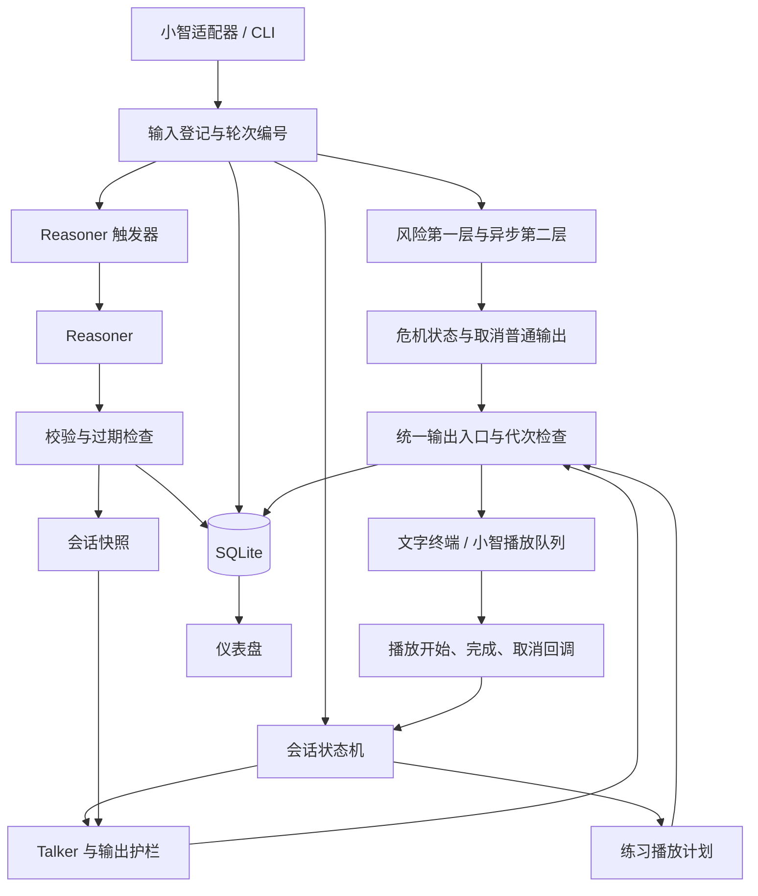

# 情感陪伴玩偶 · 后端技术设计文档 v1.1

2026-11-03 · 基于 @deng 的 v1 修订

本文档定义 companion 后端的实现、集成和验收约定，替代 v1 作为后续开发依据。保留 Talker / Reasoner、代码状态机、版本化快照、SQLite、配置驱动和文字模式的架构。研究依据来自《研究链 v3》；尚未收到的策略全文不以推测补齐。

v1.1 主要修订：统一 Aihubmix 接入；将风险检查前移到所有真实输入；明确迟到高危结果的即时接管；危机回复全部使用审核模板；将同意绑定具体提议；补齐任务过期、取消、结束和重连的处理；将练习节奏交给播放层；区分离线流程验收与真实模型、语音和硬件验收。

## 0 交付范围与待补条件

### 0.1 本版交付

- 独立 Python 包：文字对话、剧本回放、Talker / Reasoner、状态机、风险流程、练习调度、记忆和可观测性。
- 小智服务端适配与补丁、配置覆盖、安装和运行说明。
- 本地仪表盘、数据清除工具、延迟基准和演示脚本。
- 单元、剧本、并发、风险、模型接口和真机验收记录。

硬件装配、固件开发和正式服务上线不属于本后端文档的交付范围；真机联调需要可连接的开发板、麦克风、扬声器和网络。文字模式可以先完成独立后端的开发与验证。

### 0.2 尚需补齐的材料与决定

| 项目 | 当前状态 | 影响与处理 |
| --- | --- | --- |
| S03–S19 完整行动卡 | 待提供《研究链 v3》A 线策略全文或等价材料；v1 只有 S16 示例 | 可以实现卡片引擎和测试夹具；17 张正式卡片的内容验收须等待材料 |
| 危机话术 | 待人工编写或提供、审核 | 使用明确标注的测试占位文本验证接管；真实演示使用审核版本 |
| 语音合成方案 | 待接口和延迟小试后确定 | 优先调查 Aihubmix 可用 TTS；比较中文表达、首响、格式和小智接入成本，不预定 CosyVoice |
| 小智补丁范围 | I1–I4 为初始目标，取消和播放接口是否需要新增补丁待验证 | 先产出最小集成验证与具体差异；如必须扩大范围，说明原因后由项目负责人决定 |
| 开发板联调条件 | 待联调时确认 | 不阻塞文字模式；M5、M6 的真机验收需要实际设备 |

配置内容缺失与程序故障分别报告。测试夹具通过表示机制正确；完整演示验收还要求正式卡片、审核话术、语音和真机指标均达标。普通工程细节由开发者确定并记录在 `DECISIONS.md`。

## 1 需求与约束

### 1.1 目标和术语

为中国大陆高中生（15–18 岁）提供语音陪伴后端，覆盖学业、社会评价、关系、未来迷茫、自我五类压力。一次压力话题可按“开场 → 探索 → 安慰 → 征求许可 → 行动 → 收尾”推进，也允许拒绝、只陪伴、返回探索和直接退出。一次行动执行一张卡。

| 术语 | 定义 |
| --- | --- |
| 用户轮次 `turn_id` | 一次真实用户输入的持久化唯一编号；控制事件另行标记 |
| 对话轮 | 一次用户输入及其对应回复；历史窗口按此单位计算 |
| 会话 `session_id` | 从连接建立到断开的一段对话，重连分配新编号 |
| 用户 `user_key` | 玩偶设备 ID；本版按一台设备对应一位用户设计 |
| 状态 `stage` | 开场、探索、安慰、征求许可、行动、收尾、只陪伴 |
| 模式 `mode` | 普通、练习、危机；危机优先于其他模式 |
| 快照 | 当前会话的不可变分析结果，带版本号和分析截止轮次 |
| 提议 `offer` | 后端记录的一个待回应请求，包含对象、来源轮次、有效期和同意状态 |
| 输出代次 `generation` | 会话的播放版本；插话、接管、关闭时递增，使旧输出失效 |

“只用一张卡”指同一行动过程不切换卡；学生开启新话题并重新同意后可以开始新行动。每张卡另受每会话使用次数限制。设备共用、多用户身份识别如成为需求，应另行调整 `user_key` 设计。

### 1.2 使用场景

| 编号 | 场景 | 预期行为 |
| --- | --- | --- |
| U1 | 唤醒开场 | 初次介绍自己是 AI；之后优先问一条到期跟进，否则简单问候 |
| U2 | 倾诉压力 | 判断压力类型，按状态机回应；同意后执行一张行动卡 |
| U3 | 情绪很强或哭了 | 先陪伴；可提议练习，同意后播放 |
| U4 | 直接要办法 | 当轮进入征求许可，登记具体提议，立即安排后台分析 |
| U5 | 跨会话跟进 | 结束时提取有来源的事项，下次开场每条只问一次 |
| U6 | 睡前 | 提供简短陪伴或放松，尊重结束意愿 |
| U7 | 危机 | 取消普通输出，使用审核模板接管并在仪表盘提醒 |
| U8 | 退出、超时、用太久 | 退出立即断开；超时一句收尾；会话满 2 小时后提醒一次 |

### 1.3 质量要求

| 优先级 | 要求 | 验收指标 |
| --- | --- | --- |
| 1 | 风险处理 | 高危召回率 ≥ 95%，需关注召回率 ≥ 80%，无风险误判高危比例 ≤ 10%；接管时序另按第 13 节验证 |
| 1 | 危机输出 | 接管及危机后续回复全部来自审核模板，无 Talker 生成内容 |
| 2 | 首响 | 识别文字到首句提交 TTS 的中位数 ≤ 900 ms；用户说完到设备可听首响的中位数 ≤ 1.8 s |
| 3 | 可追溯 | 每轮可查状态、卡片、快照、风险、延迟、违规和中断原因 |
| 4 | 简单 | companion 不新增常驻服务进程，仪表盘除外；运行于小智进程内 |
| 5 | 可测试 | 单元和确定性剧本不联网；真实模型与设备测试单独标记 |

900 ms 和 1.8 s 保留为验收目标，不是已测结果。文本、语音、网络或播放方案不能达标时，先分析瓶颈，必要时由项目负责人决定方案变化。

### 1.4 技术约束

- 小智版本锁定为 `92337881a7b6553614b47e137a774d02bf40512f`，提交时间为北京时间 2026-11-01。上游仓库为 `xinnan-tech/xiaozhi-esp32-server`。
- Python 3.10、`openai` SDK、Pydantic v2、PyYAML、Jinja2、SQLite、Streamlit、pytest。枚举使用 `class Stage(str, Enum)`，兼容 Python 3.10。
- 远程模型统一从 Aihubmix 选择；Talker / 风险分类先用 `qwen-flash`，Reasoner 先用 `qwen-plus`。能力验证后记录实际模型 ID、参数和测试日期。
- ASR 暂保留本地 SenseVoiceSmall，由小智负责。替换 ASR 时必须验证文本、原始情绪和哭声事件的来源；缺失信号记为未知。
- LLM、记忆提供者可被多个连接共享。会话状态按 `session_id` 隔离，长期记忆按 `user_key` 保存。
- 本版实现 AI 身份说明、危机接管、退出、使用时长提醒和关系边界；这些功能不构成正式上线的法律合规结论。

## 2 架构与执行模型

### 2.1 数据流



Talker 读取会话快照，不直接调用 Reasoner。状态机消费已校验的提议；后台结果不直接更改正在输出的一轮。

### 2.2 模块职责

| 模块 | 职责 |
| --- | --- |
| `core/api.py`、`session.py` | 输入登记、会话生命周期、轮次上下文、取消与播放回调 |
| `core/state_machine.py` | R / Q 转换、提议与同意、行动次数 |
| `core/talker.py`、`prompts.py` | 提示词、流式输出、标签和切句 |
| `core/output_rail.py` | 逐句规则检查及状态备用句 |
| `core/risk.py`、`crisis.py` | 输入风险、异步结果、模板接管 |
| `core/exercise.py` | 生成语音与静音组成的播放计划，维护练习进度 |
| `core/triggers.py`、`reasoner.py`、`validator.py` | 触发、任务合并、模型分析、发布校验 |
| `core/snapshot.py`、`memory.py` | 会话快照和长期记忆整理 |
| `core/models.py`、`config.py` | 数据结构、配置解析与验证 |
| `llm/client.py` | Aihubmix 调用、超时、取消和结构化输出验证 |
| `store/` | SQLite 事务、查询和迁移 |
| `adapters/cli.py`、`adapters/xiaozhi/` | 输入来源标记、统一输出入口、实际播放和回调 |
| `dashboard/app.py` | 查询日志，确认风险事件 |

### 2.3 线程与锁

- `respond()` 为同步生成器，运行在入口的工作线程。网络调用、播放等待不持有会话锁。
- `risk_pool` 默认 4 个线程；每次提交记录原始 `session_id`、`turn_id`。600 ms 闸门等待结束不取消风险任务；任务受独立总超时限制。
- `reasoner_pool` 默认 2 个线程。同一用户只运行一个分析任务；普通触发按会话合并为最新水位，结束任务按会话单独保留。
- 同一会话只允许一个有效的普通回复代次。插话先取消旧代次，再登记新输入；旧任务可以清理资源，但不能继续提交播放或覆盖新状态。
- 会话快照及其嵌套模型使用 frozen Pydantic 模型，集合使用 tuple / frozenset 等不可变类型。冻结外层对象不能代替冻结内部列表。
- 发布结果与输入登记共用该会话的短临界区；需要用户级锁时，顺序统一为用户锁 → 会话锁 → 数据库写锁。禁止反向取锁。
- SQLite 启用 WAL、外键和 `busy_timeout`；每线程使用自己的连接。进程内写锁串行化 companion 写入，跨进程冲突由 SQLite 事务处理。
- 一次分析的快照、记忆和运行记录在同一事务提交；成功后才替换内存快照。事务失败保留旧快照并报告错误。

## 3 核心流程

### 3.1 输入与回复

1. 适配器提供明确的输入来源：`user`、`wake`、`idle_end`。真实用户恰好说了唤醒词或结束标记，仍按 `user` 处理。小智的合成输入需在适配器按调用来源标记，不能只比较字符串。
2. `on_input()` 在锁内分配持久化 `turn_id`，记录设备、文字、信号和单调时钟 `t0`，取消旧普通输出并递增代次。重复传入相同 `input_id` 返回原编号，避免重复登记。
3. **每条真实用户输入都先执行风险第一层，包括练习中和只陪伴时的输入。** 命中高危立即进入危机，不启动该轮 Talker 或风险第二层。非高危提交第二层；已经处于危机时只继续第一层记录，不再调用风险模型。
4. 进入危机后直接提交审核模板；退出和连接关闭仍然有效。控制事件不送入风险模型，也不作为学生事实写入记忆。
5. 非危机下处理开场、超时、练习打断或普通状态转换。该轮使用固定的状态、卡片和快照版本，形成 `TurnContext`。
6. `respond(session_id, turn_id)` 读取该上下文与已登记历史。普通模式流式调用 Talker；危机输出走统一输出入口，练习输出播放计划。
7. 每个可听输出的首段经过风险闸门，包括备用句和练习起始段。已得到第二层结果时先合并；未得到时最多等到 `t0 + 600 ms`，剩余等待为零时直接读取当前结果。
8. 每句经护栏后提交。适配器接收时再次验证会话、代次和模式；旧代次输出被丢弃。危机表情由模板规定，普通表情与第一句一起放行。
9. 完成或取消时记录已经提交的文本、播放状态、延迟、违规、状态前后值和结束原因；依据用户输入与触发规则调度 Reasoner。

`on_input`、`respond`、输出接收分别是登记、生成、播放三个动作。生成结束不等于播放结束；日志分别记录。用户输入的风险检测和必要分析不因回复被打断而取消。

### 3.2 开场与跟进

- 首次使用：播放 `persona.yaml` 的介绍，说明 AI 身份、陪伴边界，并询问称呼。介绍关键部分得到播放完成回调后设置 `onboarding_done=true`。
- 有到期跟进：从 `pending` 中选重要性最高的一条。提交前在事务中预留，首次实际播放时标记 `asked`；播放前被取消则释放预留。已经播放过的事项不重复问。
- 其他情况：按开场模板简单打招呼，最多一个开放问题。
- 开场普通回复完成后进入探索；期间发生危机或取消时不执行此转换。
- 跟进回答由下一次有效 Reasoner 运行关联 `followup_id` 写入。新会话读取数据库中的最新长期记忆，不恢复旧会话的行动状态。

### 3.3 收尾、退出和时长

- 用户退出：适配器立即取消输出并断开，不生成挽留回复；调用幂等的 `on_session_end(reason="user_exit")`。
- 120 秒无语音超时：入口发出 `idle_end` 控制事件，普通模式使用已有摘要或本次事实作一句收尾。危机模式使用审核后的结束模板。随后断开。
- 正常话题收尾：最多 2 轮；可以邀请回顾或确认已有的小行动。没有进入行动时，不额外强加行动要求。
- 会话累计满 7200 秒后的第一轮加入一次休息提醒；提醒实际开始播放时标记完成。危机时使用危机模板，不插入普通提醒。
- 本版时长指标按同一连接会话计算；重连后重新计时。

### 3.4 会话结束与后台收尾

1. 首次结束通知在事务中将生命周期设为 `ending`，写入结束时间、原因和最终输入水位；取消播放和普通生成。重复通知不新增结束任务。
2. 为该会话保留一项结束分析。运行中的普通任务不再发布策略；结束任务优先于尚未开始的普通任务，同一用户仍保持串行。
3. 结束分析读取该会话固定的最终历史，生成 3–5 句摘要，提取有来源的事件与跟进，更新画像。它不能修改另一会话的状态、卡片或同意。
4. 分析成功后事务写入记忆和完成状态；失败则记录失败原因，释放运行状态并允许运维手动重试。会话关闭不等待网络分析。
5. 清理会话内存；活动生成器、风险回调和播放回调均使用会话编号检查生命周期。迟到高危结果仍记入已结束会话并提醒仪表盘，但不向新会话自动播放。
6. 新会话总是从普通 / 开场开始，使用数据库最新记忆生成默认快照。旧结束分析随后更新记忆时，在新会话下一轮边界刷新核心记忆，不回写其策略判断。

结束任务的状态存入数据库。进程重启后将未完成任务标为可恢复，按最终水位重新执行；依靠来源编号和任务唯一键避免重复写入。正常关闭进程时先停止接收新任务，在配置的关闭期限内等待后台任务结束。

### 3.5 练习模式与播放

- 可提议条件：快照允许或本轮有哭声；脚本必须存在且可播放。学生拒绝、不想说或提出危机内容时优先处理该输入。
- 提议以 `exercise:<script_id>` 绑定，首次播放提议后生效。明确同意后进入练习；不把对其他问题的“嗯”视为练习同意。
- 练习由 `PlaybackPlan` 表示：有序的语音片段及其后静音时长。停顿从该片段实际播放完毕开始计算，由适配器的播放时间线执行。
- 本版固定脚本优先预生成音频，附带实测音频长度；总时长为音频时长与静音之和，最多 90 秒。文字模式用虚拟时钟验证，不用真实 `sleep` 拖慢测试。
- 用户插话时，先递增代次、停止设备播放并清空旧计划，再处理风险和新输入。模式恢复普通；高危则直接变为危机。
- 普通打断且学生没有拒绝、换题或提出新需求时，允许提出一次“继续练习”的请求；继续仍需同意。恢复位置为被打断的片段开头。
- 只有收到当前计划的完成回调才转为普通 / 安慰；迟到或旧代次回调不得改状态。

第一版目标脚本：约 60 秒呼吸、双脚踩地的落地练习、睡前放松。名称中的时长是目标，实际时长以音频与静音测量为准。脚本内容与节奏校验同属内容验收。

### 3.6 危机接管

1. 第一层或第二层得到高危，立即在锁内锁定危机模式、递增状态修订号和输出代次，撤销待处理提议与练习。
2. 记录或更新该轮风险事件，通知输出入口停止旧音频、清空旧队列、提交危机开场模板。**不等待下一次用户发言。** 同一事件的同步闸门和异步回调共享一次性接管标记。开场只在首次进入危机时播放；已处于危机的后续输入更新事件并选择后续模板，不重复进入流程。
3. 已交给设备并播放的声音无法撤回；从风险结果到取消指令、设备停止和危机首响分别计时。队列中未播放的普通文本和音频必须失效。
4. 危机后续轮次按代码规则选择审核模板；每 3 个后续用户轮次使用包含援助信息的模板。所有可听文本均来自 `crisis.yaml`，不调用 Talker。
5. 危机持续到会话关闭。仪表盘确认只表示事件被查看处理，不解除模式。结束时允许 Reasoner 整理记忆；其结果不参与危机回应。

模板未审核时，CLI / 自动测试使用显式测试占位文本；真实演示模式启动检查要求审核信息完整。危机模板缺失或损坏应在启动阶段报错。

## 4 对话状态机与同意

### 4.1 状态

| 状态 | 代码 | 行为和限制 |
| --- | --- | --- |
| 开场 | `opening` | 一轮介绍、跟进或问候 |
| 探索 | `explore` | 了解经历和感受，一次最多一个问题 |
| 安慰 | `comfort` | 认可与情感回应，不执行行动卡 |
| 征求许可 | `permission` | 请求同意、等待卡片或澄清对象；由提议子状态区分 |
| 行动 | `action` | 执行已同意的一张卡，最多 4 个有效回复轮 |
| 收尾 | `closing` | 简短回顾或确认已有行动，最多 2 轮，不挽留 |
| 只陪伴 | `quiet` | 不主动提问，不执行行动卡 |

### 4.2 提议和同意

`PendingOffer` 记录 `offer_id`、`kind`（action / exercise / resume_exercise）、`target_id`（卡片或脚本，可暂缺卡片）、`topic_revision`、`offered_turn_id`、`status` 和有效期。状态为 `awaiting_consent`、`accepted_waiting_card`、`ready`；已拒绝、已消费和已过期的提议清除并留日志。

- 同一时刻只存在一项待同意提议。后端决定请求类型，Talker 只表达；提议句使用配置模板，避免标签写了“请求同意”而实际只问了一个澄清问题。
- 提议开始播放后激活。对于口头“好”“嗯”，要求整句或限定短句匹配；拒绝 / 否定优先。“好难受”“不可以”不能命中肯定规则。
- 行动提议可以是“愿意一起试一个小办法吗”，在尚无卡片时先获得对当前话题尝试行动的同意。卡片就绪后由代码选择一张符合条件的卡；切换话题或执行另一张卡需要新的提议。
- 明确同意但卡片未就绪时，保存 `accepted_waiting_card`；可以问一个缩小范围的问题。学生回答“数学”等内容时保留同意，不因没再说“好”退回探索。
- 一项提议默认在提出后的 2 个用户轮次内可接受；已同意后最多等待后续 2 个用户轮次或 30 秒，以先到者为准。时间和轮次从接受时计算，到期后在下一输入边界转回探索并清除同意。
- 拒绝、不想说、明确换题、情绪升为高、危机或会话结束立即撤销行动同意。哭声可以触发新的练习提议，但不继承行动同意。
- Reasoner 准备好卡片后不主动插话，也不自行进入行动；下一轮由状态机检查仍有效的同意、当前意图和卡片资格，再进入行动。
- 普通未答复可用一次模板澄清；第二次仍无明确回应则返回探索。澄清问题本身不构成新的同意请求。

### 4.3 转换规则

| 编号 | 转换 | 决定方 | 条件 |
| --- | --- | --- | --- |
| R1 | 探索 / 安慰 / 只陪伴 → 征求许可 | 规则 | 要办法且本轮未拒绝，创建行动提议并触发分析 |
| R2 | 征求许可 → 行动 | 规则 | 当前或保留的有效同意 + 合格卡片；无卡保留等待状态 |
| R3 | 征求许可 → 探索 | 规则 | 拒绝、提议失效或澄清后仍未回应；普通澄清回答不触发 |
| R4 | 任意普通状态 → 只陪伴 | 规则 | 不想说，撤销提议 |
| R5 | 只陪伴 → 探索 | 规则 | 至少 15 个字且不含拒绝；短回应继续陪伴 |
| R6 | 行动 → 探索 | 规则 | 哭声或明确拒绝 / 停止当前行动；结束该行动实例 |
| R7 | 开场 → 探索 | 规则 | 开场有效完成 |
| R8 | 行动 → 收尾 | 规则 | 第 4 个有效行动回复完成后，在下轮应用 |
| Q1 | 探索 → 安慰 | Reasoner 提议 | 经过和感受已说清 |
| Q2 | 安慰 → 征求许可 | Reasoner 提议 | 情绪非高，本话题尚未主动请求过许可 |
| Q3 | 行动 → 收尾 | Reasoner 提议 | 当前卡片达到成功或退出条件 |
| Q4 | 安慰 / 征求许可 / 行动 → 探索 | Reasoner 提议 | 情绪上升、纠正、换题等有来源证据 |
| Q5 | 收尾 → 探索 | Reasoner 提议 | 学生开始新的事情 |

优先级：关闭 / 取消 → 高危接管 → 拒绝或不想说 → 哭声和行动中止 → 有效同意 → 主动要办法 → 其他规则 → Q 提议。每轮最多执行一次主状态转换；模式变化另行记录。R 转换优先于同轮 Q 提议，Reasoner 永远不能提议 `action` 或解除危机。

进入行动时固定 `action_id` 和 `card_in_use`。同一行动实例首次提交有效行动句时使用次数加 1；该实例共最多 4 个有效回复轮，后续轮不重复累计使用次数。纯生成失败或全部被护栏丢弃的回复不计为执行轮；已提交后被打断的轮计入并标注中断，避免重复执行已说过的步骤。

拒绝具体卡片时记录该卡，本会话不再使用；拒绝尚无对象的一般提议，只记录不想听办法，不把所有候选卡都标为拒绝。

### 4.4 Reasoner 触发

| 编号 | 条件 | 调度 |
| --- | --- | --- |
| T1 | 自上次分析输入水位后新增 4 个用户轮次 | 普通 |
| T2 | 悲伤、生气或害怕，且新增至少 2 轮 | 普通 |
| T3 | 哭声 | 当轮登记后尽快 |
| T4 | 要办法或同意后缺卡 | 当轮登记后尽快 |
| T5 | 拒绝或纠正 | 当轮登记后尽快 |
| T6 | 需关注风险，包括迟到结果 | 结果登记后尽快 |
| T7 | 会话结束 | 独立保留的结束任务 |

T3–T6 不等待 Talker 输出完成。已运行任务不被重复启动，后续触发只提升该会话待运行任务的输入水位并合并原因。进入危机后停止普通策略分析，结束时按 T7 整理记忆。

## 5 Talker 与输出协议

### 5.1 提示词和上下文

系统提示词由 `prompts/talker.j2` 组合：角色 → 说话规则 → 当前状态 → 当前行动卡 → 核心记忆 → 本轮信号 → 输出格式。系统提示词目标不超过约 1500 token，核心记忆不超过约 200 个中文字。超长时优先裁剪低重要性记忆，不删除角色边界和状态约束。

历史窗口是最近 10 个已登记的用户对话轮及其已提交回复，加当前用户输入一次。控制事件、标签、取消前未提交的模型文本不进入历史。没有实际播放确认的历史在上下文中标注“已提交，播放未确认”；被打断的回复标注已知范围。用户文本和记忆以数据段传入，不能覆盖系统规则。

初始参数为 `temperature=0.7`、`max_tokens=160`、`stream=True`，关闭思考。具体关闭参数必须通过模型能力小试确认后配置，不能向所有模型无条件发送同一厂商参数。

### 5.2 标签

```text
<<state=action;card=S16;emo=🤔;offer=->>
先不问“我为啥总这样”。那天具体是怎么发生的？
```

| 字段 | 校验 |
| --- | --- |
| `state` | 必须等于该轮固定状态 |
| `card` | 行动时只能为固定卡 ID；其他状态为 `-` |
| `emo` | 允许列表内单个表情，否则使用配置默认表情 |
| `offer` | `-` 或存在且本轮允许的练习 ID；模型仅提出候选，后端决定是否发出提议 |

标签最多缓存 256 个 Unicode 字符，直到首个换行；缺失或不合法时记录违规并使用固定状态 / 固定卡片 / 默认表情。看起来像损坏标签的头部剥离，避免播出字段；纯正文没有标签时保留正文。标签跨 token 到达的行为必须测试。

行动许可由状态机和模板产生，无需依赖模型标签。练习候选获准后，也由模板输出明确的提议，记录其实际播放再激活同意请求。

### 5.3 切句与护栏

- 在 `。！？!?…；` 或换行切句；不足 4 个字的片段与后续片段合并，流结束时处理尾部。
- 普通回复最多放行 3 句，每句目标约 25 字以内，一次最多一个问题；提议模板占用其中的句数和问题额度。
- 护栏覆盖套话、说教、评论长相、医疗 / 政策建议、亲密关系，以及非行动状态下的行动建议。卡片 `never_say` 同样参与检查。
- 练习邀请、退出、休息提醒等系统模板按其用途校验，不使用普通“非行动建议”规则误删。危机模板单独审核、固定选择。
- 不合格句丢弃并记录类别；全被丢弃时使用该状态的备用句。备用句在启动时通过适用规则检查。
- 正则可约束明确表达，不能证明所有语义违规已消除；真实模型剧本还需抽查状态符合性和不合适建议。

### 5.4 时间与错误

- 首 token 超时初值 2500 ms，整轮模型总超时初值 10 s；二者使用单调时钟，包含请求和排队时间。自动 SDK 重试默认关闭，重试必须计入同一总预算。
- 超时或网络错误输出状态备用句，仍通过风险闸门。已经放行部分正文时不追加重复备用句，记录部分完成。
- 用户取消、输出代次过期、`GeneratorExit` 只清理资源和记录中断，不输出备用句。禁止在关闭生成器的 `finally` 中 `yield`。
- 接口边界捕获可报告的普通异常，保存上下文。配置、数据库不可用等启动故障直接失败；运行时无法记录或输出时由适配器中止当前轮并报告，不伪装成功。

## 6 Reasoner、校验与发布

### 6.1 输入

最近 12 个用户对话轮及回复，包含持久化编号、声音信号、状态与卡片；当前会话快照、提议、行动记录、画像、事件和待跟进；已启用卡片目录；触发原因。

任务启动时冻结 `session_id`、`source_turn_id`、`state_revision`、`topic_revision` 和 `base_snapshot_version`。这些值由代码提供，模型不能修改。用户新输入、规则转换、取消提议、危机和关闭均更新相关修订号。

目标耗时 ≤ 8 s，总预算 20 s。`temperature=0.2`；优先使用验证过的 JSON 输出参数，再用 Pydantic 检验。格式失败最多重试一次，仍在原 20 s 预算内。

### 6.2 输出结构

```json
{
  "assessment": {
    "pressure_types": [{"type": "academic", "confidence": 0.7}],
    "pathway_signals": ["rumination"],
    "seeker_state": {"emotion_intensity": "high", "trust": "medium", "initiative": "student", "readiness": "low"},
    "user_pref": "listen",
    "risk_level": "none",
    "user_state": "月考退步，反复想自己是不是不行"
  },
  "stage_proposal": {"to": "comfort", "reason": "经过已说清，情绪仍强", "source_turn_ids": [12]},
  "cards": {"allowed": [], "preferred": null, "evidence": []},
  "offer_exercise": false,
  "topic_changed": false,
  "memory": {
    "profile_updates": [{"field": "interests", "value": "画画", "source_turn_ids": [12]}],
    "events": [{"summary": "月考排名下降二十名", "pressure_type": "academic", "date": null, "importance": 7, "source_turn_ids": [10]}],
    "followups": [],
    "followup_results": []
  },
  "session_summary": null
}
```

压力类型固定为 `academic / social_evaluative / relationship / future / self`；路径固定为 `rumination / self_criticism / sleep / loneliness`。强度、信任、准备度为 `low / medium / high`；偏好为 `listen / solve / unknown`。置信度范围 0–1，重要性范围 1–10。

`stage_proposal` 可为 null。卡片 `evidence` 为每张候选的 `{card_id, when_met, exclusions_present, source_turn_ids}`；评估涉及自然语言的适用和排除条件，代码再校验证据与结构化限制。日期不明确时为 null，不把当前日期当事件日期。摘要只在结束任务填写；风险只允许 none / watch，不能覆盖风险检测器的高危结果。

### 6.3 校验

| 编号 | 规则 | 处理 |
| --- | --- | --- |
| V1 | 结构、枚举和范围合法 | 限预算重试一次，仍失败保留旧快照 |
| V2 | 状态提议属于 Q1–Q5，有有效用户来源 | 无效则忽略；不能提议 action |
| V3 | 卡片存在、启用，目标匹配，有适用证据且无排除条件 | 去掉不合格卡 |
| V4 | 卡片未被拒绝、未超次数，当前情绪 / 准备度满足结构化限制 | 去掉不合格卡；进入行动前再检查当前条件 |
| V5 | 推荐卡属于 allowed | 改为第一张；无可用卡则 null |
| V6 | 记忆及证据引用真实存在、同一用户、当前输入上下文中的用户轮次 | 无来源或引用控制事件 / 回复则拒绝；画像仅允许声明字段 |
| V7 | 新跟进有来源和明确可解析日期；pending 最多 2 条 | 日期不明确则不排期；去重后按重要性保留，记录被丢弃原因 |
| V8 | 危机或结束任务只允许记忆相关结果 | 删除策略、模式和卡片更新 |

目标匹配规则：卡片压力类型和路径均为空才表示不限；否则任一非空目标集合与评估相交即可。空的一侧不充当“全部匹配”。适用 / 排除条件不因目标相交而省略。

新建跟进日期不早于当前业务日期；已有逾期 `pending` 保留到开场询问，不删除。V6 检查来源归属与角色，内容是否被来源支持还需记忆剧本验证。

### 6.4 发布与过期结果

- 在短临界区检查任务身份、生命周期、输入水位、状态修订和基础快照版本。任一过期则普通任务记为 `superseded`，不发布其策略或记忆，合并一次面向最新输入的重跑。
- 比较状态名称不够：探索 → 征求许可 → 探索也会增加修订号，因此旧提议不能重新生效。
- 有效结果生成新不可变快照，在数据库事务成功后整份替换。`stage_proposal` 作为待执行提议保留到轮次边界，不改变正在生成的回复。
- 下一轮先执行输入风险和 R 规则，再决定是否采用仍合法的 Q 提议；本轮有规则转换或新的否定 / 纠正时放弃旧提议。
- 结束任务允许基于固定最终历史写长期记忆；按来源轮次时间防止旧事实覆盖已有较新画像值。事件与跟进按用户、来源和规范化内容去重。
- 同一用户的待结束任务按结束时间执行，然后运行活动会话最新的普通任务。完成一个任务后检查待运行项，不能用一个布尔“重跑”标记丢失结束类型。

## 7 风险与数据边界

### 7.1 等级和模型结果

| 等级 | 含义 | 行为 |
| --- | --- | --- |
| `none` | 未识别到风险信号 | 普通流程 |
| `watch` | 绝望、想消失、撑不下去、严重欺凌等间接信号 | 写风险事件，触发分析，保持陪伴 |
| `high` | 明确自伤 / 自杀念头、计划或方法，或正在遭受虐待 | 危机接管 |

第一层从 `risk_lexicon.yaml` 同步匹配，第二层读取本轮及前 2 个用户轮次的原话，输出 `{level, category, reason}`，类别为 `suicide / self_harm / abuse / other`。第二层输出验证失败、异常或超时记录独立状态，不能写为“模型判断 none”。

### 7.2 闸门与迟到结果

- 风险结果按严重程度合并，不降低第一层结果。第二层默认总超时 2500 ms，从提交算起，包括线程池等待；请求启动时使用剩余预算。
- 闸门到期仍未完成时，以第一层结果放行，并记录 `gate_pending`。最终结果回调独立于 Talker 和生成器存活，不能只在下一轮读取 future。
- 迟到 high 对原会话立即执行 3.6；即使已开始新一轮，只要同一会话仍活动，仍接管整个会话。原会话已结束则只更新风险事件与提醒。若底层请求未能在截止时间取消而稍后返回有效 high，仍接管并标记超预算；none / watch 的迟到结果不撤销超时提醒。
- 最终超时、异常、队列已超过截止时间时，将本轮至少标为 watch，记录检测未完成并提醒仪表盘。该策略不能替代高危识别，相关样本计入时限验收的失败项。
- 危机检测回调优先更新状态与取消输出，再提交持久化和通知工作；持久化失败须显式上报，并保持危机锁定。去重使用 `(session_id, turn_id)` 与接管状态。

### 7.3 危机模板与通知

`crisis.yaml` 包含开场、倾听回应、援助信息、紧急危险提示和结束模板，以及版本、审核人、审核日期。具体文本与援助联系方式由人工审核材料提供；本次修订不生成话术。

仪表盘红色展示未处理风险；可配置 webhook，默认关闭。通知载荷默认只含事件编号、等级、时间和本地会话标识，不附带整段对话。网络通知异步执行、有超时；失败记录在事件上，不阻塞接管。

### 7.4 数据和关系边界

- 首次说明 AI 身份，被问到时如实回应；不扮演恋人或家人，不诱导排他依赖。
- 应用持久化数据保存在本地 SQLite；本地 ASR 不上传音频。Talker、风险分类和 Reasoner 会将必要文本上下文发送至 Aihubmix / 对应模型服务；如采用云 TTS，还会发送待合成文本。
- 因而“本地存储”不表示“数据不出设备”。运行说明须列出实际发送的字段和所用服务。SDK 请求日志不得包含密钥。
- 不保留用户录音；小智 `delete_audio: true` 的实际文件行为在集成验收中验证。固定练习脚本的生成音频可作为非用户内容缓存。
- `purge_user.py` 在关闭该用户会话并取消 / 排空相关后台任务后，事务删除其记忆、轮次、快照和日志，清理内存。防止迟到回调重新写回已删除数据。

## 8 数据模型与存储

### 8.1 会话与快照

以下是实现必须覆盖的字段约定；Pydantic 模型统一放在 `core/models.py`，从属模型需定义完整。

| 模型 | 核心字段 |
| --- | --- |
| `TurnSignals` | emotion 可空、events tuple、received_at UTC 时间；缺失信号为未知 |
| `TurnContext`（不可变） | session_id、turn_id、generation、stage、mode、card_id、snapshot_version、signals、trigger_reasons |
| `SessionState` | session_id、user_key、lifecycle、stage、mode、state_revision、topic_revision、generation、latest_turn_id、started_at |
| 会话交互字段 | pending_offer、action_id、card_in_use、action_turns、cards_used、cards_refused、permission_asked_topic、rest_reminded、active_plan_id |
| `Snapshot`（不可变） | session_id、user_key、version、source_turn_id、created_at、trigger、stage_proposal、pressure_types、pathway_signals、seeker_state、allowed_cards、preferred_card、offer_exercise、user_pref、risk_level、user_state、core_memory |
| `CoreMemory`（不可变） | profile_brief、active_stressors（最多 3 条）、followups_due（最多 2 条）、last_session_summary |
| `ReasonerTask` | session_id、user_key、kind、trigger_reasons、source_turn_id、state_revision、topic_revision、base_snapshot_version、status |

快照按会话保存，版本在会话内递增。用户长期记忆单独保存。新连接不会继承旧连接的提议、卡片、危机锁或快照版本。

可变会话中的 dict / set 使用 `Field(default_factory=...)`；快照中的嵌套模型均冻结，集合使用不可变类型。时间戳存 UTC，业务日期和“到期”按 `Asia/Shanghai`；延迟使用单调时钟，不相减墙上时钟。

### 8.2 表结构约定

| 表 | 字段与约束 |
| --- | --- |
| `users` | user_key 主键、created_at、onboarding_done |
| `profile` | user_key 主键、nickname、important_people、interests、effective_comfort、notes、字段来源与更新时间；复合内容为 JSON |
| `sessions` | session_id 主键、user_key、started_at、ended_at、end_reason、lifecycle、final_turn_id、summary、end_task_status |
| `turns` | id 主键、session_id、user_key、input_id、parent_turn_id、idx、role、input_kind、text、signals、stage_before / after、mode、card、snapshot_version、risk_level、latency、violations、output_status、interrupted、created_at；输入 input_id 唯一 |
| `events` | id、user_key、summary、pressure_type、people、event_date 可空、importance、status、source_turn_ids、created_at |
| `followups` | id、user_key、kind、content、due_date、importance、status、reservation_session_id、asked_at、result、source_turn_ids、created_at |
| `snapshots` | session_id、version 复合主键、user_key、source_turn_id、data、trigger、created_at |
| `card_usage` | id、session_id、action_id、card_id、outcome、turn_id、created_at；同一 action_id 的 used 事件唯一 |
| `risk_events` | id、session_id、turn_id、level、source、category、matched、reason、detection_status、timings、handled、handled_at、notification_status、created_at；session_id / turn_id 唯一并可升级等级 |
| `reasoner_runs` | id、session_id、user_key、kind、triggers、source_turn_id、base_snapshot_version、started_at、duration_ms、status、result、rejected、published_version |
| `end_tasks` | session_id 唯一、final_turn_id、status、attempt_count、last_error、updated_at |

回复通过 `parent_turn_id` 关联用户输入；控制事件以 `input_kind` 区分。记忆来源可引用历史用户轮次，不能引用 wake / idle_end。SQLite `PRAGMA user_version` 管理 schema 版本。建立会话轮次、用户跟进、风险未处理状态等实际查询需要的索引。

`followups.status` 为 pending / reserved / asked / done / dropped；`reasoner_runs.status` 为 ok / json_error / timeout / error / superseded / cancelled。JSON 字段由模型序列化并在边界验证。

### 8.3 记忆规则

- 只有校验后的 Reasoner 结果写画像、事件和跟进内容；代码可以维护 onboarding、预留 / 已问、清理和生命周期元数据。
- 画像更新保留字段级来源；清楚的较新更正优先于较旧事实。缺少证据时保留原值。
- 核心记忆由代码从数据库选择：画像摘要目标最多 120 字、最多 3 个重要进行中事件、最多 2 条到期跟进、上次摘要；再按提示词预算裁剪。
- 跟进去重及结果更新必须引用具体编号，不靠重复插入相似文本。进程重启释放没有实际播放记录的预留。

## 9 配置与内容

### 9.1 文件

| 文件 | 内容 |
| --- | --- |
| `settings.yaml` | 提供方、模型、时间预算、队列、存储、运行模式 |
| `persona.yaml` | 名字、性格、角色边界、初次介绍 |
| `rules.yaml` | 说话规则、表情、文字转换规则、护栏 |
| `stages.yaml` | 各状态指令、备用句、许可 / 澄清 / 等待模板 |
| `cards/S03.yaml` … `S19.yaml` | 正式行动卡、适用条件、步骤、来源 |
| `exercises/*.yaml` | 固定脚本、音频片段、停顿和总时长 |
| `crisis.yaml` | 审核模板及审核元数据 |
| `risk_lexicon.yaml` | high / watch 的分类正则 |
| `prompts/*.j2` | talker、reasoner、risk、session_end 模板 |

### 9.2 设置示例

```yaml
runtime:
  mode: development  # development | demo
  timezone: Asia/Shanghai
llm:
  base_url: https://aihubmix.com/v1
  api_key_env: AIHUBMIXKEY
  talker_model: qwen-flash
  risk_model: qwen-flash
  reasoner_model: qwen-plus
  sdk_max_retries: 0
timing:
  gate_timeout_ms: 600
  risk_total_timeout_ms: 2500
  talker_first_token_timeout_ms: 2500
  talker_total_timeout_s: 10
  reasoner_target_s: 8
  reasoner_timeout_s: 20
  rest_reminder_s: 7200
  exercise_max_s: 90
  shutdown_grace_s: 25
dialogue:
  history_turns: 10
  reasoner_context_turns: 12
  reasoner_every_n_turns: 4
  max_sentences: 3
  max_action_turns: 4
  offer_valid_turns: 2
  accepted_wait_turns: 2
  accepted_wait_s: 30
pools:
  risk_workers: 4
  reasoner_workers: 2
storage:
  db_path: data/companion.db
  busy_timeout_ms: 5000
alert_webhook: null
```

所有密钥由环境变量提供。开发入口允许显式指定 `.env` 路径并加载 `AIHUBMIXKEY`，已有进程环境优先；若使用 `python-dotenv`，在依赖中声明。`.env`、数据库、用户日志和运行音频加入 `.gitignore`，`.env.example` 只含空值。

`demo` 启动要求正式卡片目录完整、危机话术审核元数据完整、所选语音配置可用。`development` 可以使用明确标为 fixture 的卡片和危机占位文本，界面和报告显示该模式。

### 9.3 行动卡格式示例

以下结构沿用 v1 的 S16，内容与来源仍待《研究链 v3》核对，不能由本示例推定其余 16 张卡。

```yaml
id: S16
name: 从“为什么”到“怎么做”
status: draft
targets:
  pressure_types: []
  pathways: [rumination]
requires_permission: true
constraints:
  excluded_emotion_intensities: [high]
reasoner:
  when_any: [学生反复问为什么自己总是这样, 同一件事连续三轮没有新信息]
  not_when: [学生还没觉得被听见, 情绪强度为高]
  success: 学生说出一个具体经过或下一步
  exit: 学生表示没用或情绪上升
talker:
  steps: [温和指出反复思考, 从为什么转向具体经过, 讨论一个小的下一步]
  examples: [先不问“我为啥总这样”，那天具体是怎么发生的？]
  never_say: [你又在钻牛角尖]
limits:
  per_session: 1
emo: "🤔"
source:
  document: 研究链 v3
  location: A 线策略全文 / S16
  verification: pending
```

编号统一为 S03–S19。启动校验检查 ID、引用、模板备用句、正则编译、练习媒体和时长；未启用卡片不进入 Reasoner 目录。新增依赖应同步更新环境声明和锁文件。

## 10 小智集成与语音验证

### 10.1 已核实的接口事实

- LLM 提供者 `response(session_id, dialogue)` 为同步迭代接口。
- 记忆提供者 `save_memory(msgs, session_id)` 和 `query_memory(query)` 为异步方法；调用方会等待 query 的结果。
- `startToChat` 在解析 ASR 内容后执行意图处理，再提交聊天任务，适合登记输入；还需覆盖合成唤醒和超时事件的来源。
- 消费 LLM 流的循环通过 `client_abort` 判断是否退出，该循环没有显式保证立即 `.close()`。取消必须使用独立通知，不能依赖垃圾回收触发 finally。
- 输出还要经过 TTS 文本和音频队列；向 LLM 消费者提交字符串不能证明设备已经播放完毕。

### 10.2 初始补丁目标

| 编号 | 上游位置 | 内容 |
| --- | --- | --- |
| I1 | 新增 `core/providers/llm/companion/companion.py` | `LLMProvider` 继承基类；获取本任务绑定的 turn_id，迭代核心输出事件，转交统一输出入口 |
| I2 | 新增 `core/providers/memory/companion_memory/companion_memory.py` | 构造 `(config, summary_memory=None)`；`async query_memory` 返回空串；`async save_memory` 调用幂等结束入口 |
| I3 | `core/providers/asr/utils.py` | 保持原字段，新增 raw_emotion、event，适配器归一为 events tuple |
| I4 | `core/handle/receiveAudioHandle.py` | 登记输入、绑定 session / turn / generation 与线程池任务；传递原话和事件来源 |

所有补丁放在 `xiaozhi_patch/`，保留上游相对路径并提供基于锁定提交的 diff。`get_core(config_dir)` 返回进程内唯一核心，首次初始化确定配置；后续不同配置请求应报错。

I4 必须把不可变轮次上下文传给该次任务，例如通过显式任务包装器与 `contextvars.copy_context()`；不能在 I1 执行时从共享连接读取“最后一轮”来猜测 turn_id。provider 的 dialogue 仅供适配兼容，核心历史从已登记轮次读取。

登记失败时停止本轮 companion 生成并报告错误，避免丢失身份或风险检查后仍继续对话。普通业务异常由核心处理；I4 不使用“记日志后继续不受控对话”的兜底。

### 10.3 必须验证的播放能力

| 能力 | 集成验证 |
| --- | --- |
| 插话取消 | 新输入、显式 abort、断开都能通知核心；旧代次不再进入队列 |
| 异步危机接管 | Talker 已结束、设备仍在播时也能清队列、停止音频并提交危机模板 |
| 练习时间线 | 播放片段 → 实际静音 → 下一片段；实际总时长 ≤ 90 s |
| 播放回调 | 提供 started / completed / cancelled / failed，含原会话、代次、output_id |
| 控制事件来源 | 合成唤醒和超时不会与同字面的真实用户输入混淆 |
| 轮次隔离 | 两个连续输入不会复用同一个共享 abort 标志导致旧输出复活 |

若 I1–I4 和现有扩展点不能完成以上行为，提交最小额外改动提案，附失败复现、目标文件、接口变化和测试。扩大补丁范围须由项目负责人决定；功能验收标准保持不变。

### 10.4 配置覆盖

```yaml
selected_module:
  ASR: FunASR
  LLM: CompanionLLM
  Memory: companion_memory
  Intent: nointent
LLM:
  CompanionLLM:
    type: companion
    config_dir: /path/to/companion/config
Memory:
  companion_memory:
    type: companion_memory
    config_dir: /path/to/companion/config
enable_greeting: true
enable_wakeup_words_response_cache: false
exit_commands: [退出, 关闭, 不聊了, 拜拜, 我要睡了]
end_prompt:
  enable: true
  prompt: "（结束）"
close_connection_no_voice_time: 120
delete_audio: true
```

本覆盖片段尚未指定 TTS；完成 10.5 后补入实测可用的 provider、模型、voice、采样率及格式。安装时明确 `.env` 的路径和加载入口，不依赖任意工作目录自动发现。

### 10.5 Aihubmix 接口与语音小试

2026-11-03 已使用本地密钥成功查询模型列表，包含 qwen-flash、qwen-plus 及部分版本化名称；这只验证鉴权和列表可见性。未在该次审阅中验证生成、模型延迟、额度或语音调用。

小试分别检查：文本 SSE、首 token 和首句延迟、关闭思考参数、JSON 输出及降级响应头、中文 TTS、音频格式、首可播放音频时间。候选模型均以实际可调用结果为准，记录模型 ID 与服务返回的版本信息。

Aihubmix 的 TTS 文档存在“实时音频”描述与末尾“不支持流式输出”的不一致，不能据此保证低延迟；此次账户模型列表也未检出 CosyVoice。先做语音调用与端到端测量，再确定语音方案。若需要 Aihubmix 之外的服务或改变验收目标，提交选项与实测依据，由项目负责人决定。

SenseVoiceSmall 保留时验证 raw_emotion 和 Cry 的实际输出；缺少这些信号的替代 ASR 不能直接视为等价。固定危机和练习音频可预生成以验证播放机制，普通动态回复仍须独立满足首响指标。

## 11 模块接口契约

v1.1 保留同步生成流程，增加显式输入身份、输出事件和播放回调。小智原 LLM 接口仍返回字符串；适配器负责把核心事件映射到上游能力。

```python
class CompanionCore:
    def bind_output(self, session_id: str, device_id: str, output: OutputPort) -> None: ...
    def on_input(
        self, session_id: str, input_id: str, text: str, signals: TurnSignals, kind: InputKind
    ) -> int: ...
    def respond(self, session_id: str, turn_id: int) -> Iterator[OutputEvent]: ...
    def on_interrupt(self, session_id: str, generation: int, reason: str) -> None: ...
    def on_playback_event(self, event: PlaybackEvent) -> None: ...
    def on_session_end(self, session_id: str, reason: str) -> None: ...


class OutputPort(Protocol):
    def submit(self, event: OutputEvent) -> None: ...
    def cancel_before(self, session_id: str, generation: int) -> None: ...


class LLMClient(Protocol):
    def stream_chat(
        self, model: str, messages: list[dict], cancel: threading.Event, deadline: float, **params
    ) -> Iterator[str]: ...
    def complete_json(
        self, model: str, messages: list[dict], schema: type[BaseModel], deadline: float, **params
    ) -> BaseModel: ...


class SnapshotStore:
    def get(self, session_id: str) -> Snapshot: ...
    def publish(self, task: ReasonerTask, update: ValidatedUpdate) -> PublishResult: ...


class Reasoner:
    def submit(self, session_id: str, trigger: str, kind: TaskKind) -> None: ...


class ExercisePlayer:
    def build_plan(self, script_id: str, context: TurnContext) -> PlaybackPlan: ...
```

代码块为签名契约，相关类型需在实现中完整定义。`OutputEvent` 有 text、exercise_plan、crisis_plan 三种类型，共同携带 `output_id / session_id / turn_id / generation`；text 含表情和已放行正文，plan 含固定片段、静音和模板版本。`PlaybackEvent` 包含对应标识、状态和时间。

- 普通生成器由适配器逐个转交 `OutputPort.submit`；计划交给播放调度器，不能把对象序列化为 TTS 文本。小智桥接中，每个 text 事件只派发一次：通过上游字符串迭代入口或直接播放入口二选一，不能同时 yield 正文又直接入队。P0 必须验证上游 FIRST / LAST 标记、历史记录和计划完成的配合，再确定桥接实现。
- 危机入口直接通过已绑定的同一 OutputPort 提交事件，确保没有活跃生成器时也能接管；普通生成器检测危机后停止，不重复提交模板。
- OutputPort 线程安全、按 output_id 幂等、提交非阻塞；网络和设备操作转到所属事件循环。submit 返回只表示已接收，后续是否播放由回调确认。
- 核心先更新 generation，再调用 cancel_before；适配器接收事件与真正送入播放队列时均丢弃旧代次。关闭会话注销输出端口。
- 核心保存取消事件；模型流和计划调度及时检查取消，网络读等待由超时约束。不能把 `Future.cancel()` 当成已运行线程的终止机制。

CLI 使用相同核心与 OutputPort；普通文本打印、练习使用可切换的虚拟 / 实时时钟，异步危机消息可主动显示。FakeLLM 和 FakeOutputPort 提供可控的完成、延迟与取消事件。

## 12 可观测性与仪表盘

### 12.1 计时

| 指标 | 起止点 |
| --- | --- |
| signal_to_respond_ms | on_input 登记 → respond 开始 |
| first_token_ms | t0 → 模型首 token |
| first_sentence_ms | t0 → 首句组装完成 |
| gate_release_ms | t0 → 首句通过风险闸门 |
| tts_submit_ms | t0 → 适配器实际提交首句 TTS |
| total_ms | t0 → 生成结束，不含排队播放尾部 |
| risk_l2_ms | 提交分类任务 → 完成；另列排队时间和结果状态 |
| crisis_dispatch_ms | 获得 high → 提交取消与危机计划 |
| crisis_stop_ms | 获得 high → 设备停止旧音频 |
| crisis_first_audio_ms | 获得 high → 设备播放危机首响 |
| end_to_end_first_audio_ms | 用户说完 → 设备可听首响 |

数值缺失时记 null，原因另列 timeout / cancelled / unavailable，不在数值列混入字符串。不同设备时钟未同步时，端到端指标通过共同录音 / 录屏或同步后的日志测量。

### 12.2 记录

每轮保存固定上下文、转换原因、提议与同意、行动 ID、快照版本、提交文本、播放结果、风险与违规。违规包括 missing_tag、tag_state_mismatch、card_not_allowed、rail_*、too_many_sentences、llm_error；取消和过期是执行状态，不统计为模型违规。

分析记录保留输入水位、版本、结果、被拒绝字段和过期原因。风险事件记录闸门内 / 迟到 / 超时、接管步骤和通知结果。日志避免复制密钥和完整请求头。

### 12.3 仪表盘

每 2 秒刷新当前会话、风险提醒、Reasoner 运行和统计四个页面。统计展示样本量、中位数、P90、错误 / 超时率及运行模式。

查询连接只读。唯一写操作“标记风险已处理”使用独立短事务，将 handled 和 handled_at 更新；它受 SQLite 跨进程写锁约束，不使用仅存在于 companion 进程的全局锁。失败时提示重试，不能显示虚假的成功状态。

## 13 测试与验收

### 13.1 离线单元测试

`pytest -m "not online and not hardware"` 不联网，使用 FakeLLM、FakeOutputPort 和可控时钟。至少覆盖：

- 配置、卡片 ID、模板、正则、运行模式与未审核材料检查。
- 标签合法 / 损坏 / 缺失 / 分片；切句、护栏、备用句与模板例外。
- R1–R8、Q1–Q5、优先级；同意对象、有效期、拒绝和无卡等待；行动次数。
- V1–V8、T1–T7、结构化输出降级、同预算重试、错误和超时。
- 快照及嵌套对象不可变，版本递增，事务失败时内存不提前发布。
- 记忆来源属于正确用户与角色，较旧画像不覆盖较新事实，跟进预留与恢复。
- 插话、关闭、生成器 close、模型超时的差异；取消后无备用句或旧输出。
- 练习计划总时长、静音位置、打断、恢复、旧计划回调和危机抢占。

### 13.2 基础剧本

| 剧本 | 检查 |
| --- | --- |
| 初次使用 | AI 介绍、播放完成后 onboarding |
| 开场跟进 | 到期排序、只问一次、取消前未播放可恢复 |
| 五类压力各一个 | 状态推进、适用卡片、同一行动只用一张卡 |
| 主动要办法 | 明确提议、同意、进入行动 |
| 拒绝办法 | 返回探索，拒绝具体卡时不再出现 |
| 不想说 | 只陪伴不提问，恢复探索规则 |
| 哭声与练习 | 提议、同意、计划播放、普通打断 |
| 危机 | 第一层 high 无模型调用；模板接管、模式持续、风险事件 |
| 会话结束 | 摘要、跟进、幂等结束、下次开场 |
| 满 2 小时 | 提醒开始播放后只记一次 |

共 14 个基础剧本。使用夹具卡验证机制，正式卡片就绪后再运行内容验收。真实模型剧本除禁用说法外，还检查许可、危机模板来源、卡片资格和引用等可由代码观测的不变量。

异步完成由测试步骤显式控制，避免依靠运行速度碰巧得到卡片。例如：

```yaml
steps:
  - user: 那我该怎么办
    expect: {stage: permission, offer: action}
  - playback: offer_started
  - user: 好，你说
    expect: {stage: permission, offer_status: accepted_waiting_card}
  - complete_reasoner: {fixture: eligible_card}
  - user: 数学最让我担心
    expect: {stage: action, card: S16}
```

该示例中的 S16 为已声明具备适用证据的测试夹具，不以“数学”这一句话推断其研究适用性。

### 13.3 时序与并发剧本

| 情况 | 必须满足 |
| --- | --- |
| 第二层 599 / 601 ms 返回 high | 闸门内不放行；迟到立即接管，不等下一轮 |
| 普通生成结束后返回 high | 播放入口仍收到取消和危机事件 |
| 练习中高危输入 | 先停止计划并检测风险，不进入普通续练习分支 |
| 退出后旧风险回调 | 更新原事件，不向新连接播放 |
| 状态探索 → 许可 → 探索 | 旧 Reasoner 结果因修订号过期被拒绝 |
| 同意后卡片未就绪 | 同意有效期内保留；澄清答案不会误当拒绝 |
| 普通任务运行中会话结束 | 结束任务不被重跑标记吞掉 |
| 结束后立即重连 | 旧分析不改新会话状态；新记忆在边界刷新 |
| 用户 A / B 并发 | 无交叉状态、记忆来源或播放 |
| 用户插话时模型阻塞 | 取消通过独立入口生效，不能等待下一个 token |
| 队列旧音频和旧完成回调 | 旧代次失效，不能恢复普通模式或完成新提议 |
| 数据清除时有后台任务 | 清除后不会由迟到写入恢复数据 |

### 13.4 风险回归

风险集至少 120 条中文，高危 / 需关注 / 无风险各 40 条，包含玩笑、转述、歌词、间接表达、否定和上下文变化。每条包含标签、标签理由、上下文和来源类别，单独维护回归集；调词表和提示词用的开发样本不混作独立评估。

验收同时报告：

1. 分类器原始判断及组合策略混淆矩阵：高危召回 ≥ 95%，需关注召回 ≥ 80%，无风险误报高危 ≤ 10%。失败 / 超时单列，不作为正确 none。
2. 在风险总预算内触发 high 的系统召回率 ≥ 95%；最终正确但超出预算的结果不计入这一指标。
3. 确定性时序测试中：得到 high 后 100 ms 内向 FakeOutputPort 提交取消与危机事件，重复回调只接管一次；这是核心调度测试门槛，不等于设备停止保证。
4. 真机记录危机取消、停止旧音频和模板首响的中位数、P90、最大值及失败次数；出现接管丢失、需要再说一句才接管或继续播完普通队列，即判失败。

在线回归通过 `pytest -m online` 运行；换模型、风险提示词或词表后重跑。报告实际计数和样本量，例如高危 40 条中至少 38 条命中对应 95%；不将这一小样本结果外推为真实人群表现。

### 13.5 延迟与真机

- 模型能力测试、真实模型剧本、风险回归、延迟基准均标记 online；设备测试另标 hardware。
- `scripts/bench_latency.py` 至少运行 30 个有效普通文字轮，记录模型、参数、上下文长度、网络环境和热 / 冷状态。普通、练习、危机和备用句分别统计。
- 文本验收以 `tts_submit_ms` 中位数 ≤ 900 ms 为准；CLI 的 gate_release 作为核心参考。错误、超时样本另报，不能通过剔除失败样本隐瞒总体表现。
- 真机至少完成学业压力和危机两类剧本，并扩充普通对话至至少 30 个首响样本，端到端首响中位数 ≤ 1.8 s；记录 P90。检查表情、插话、迟到高危和练习实际静音。
- 仅运行成功或 pytest 退出码为零不能替代内容和播放检查；验收记录附配置版本、测试结果和必要录屏。

## 14 代码组织与里程碑

### 14.1 目录

```text
companion/
  pyproject.toml
  README.md
  AGENTS.md
  DECISIONS.md
  companion/
    core/       api.py session.py state_machine.py talker.py output_rail.py
                risk.py crisis.py exercise.py triggers.py reasoner.py
                validator.py snapshot.py memory.py prompts.py config.py models.py
    llm/        client.py fake.py
    store/      db.py schema.sql repo.py
    adapters/   cli.py xiaozhi/
    config/     settings.yaml persona.yaml rules.yaml stages.yaml crisis.yaml
                risk_lexicon.yaml cards/ exercises/ prompts/
    dashboard/  app.py
  tests/        unit/ scenarios/ fixtures/ risk_set.jsonl conftest.py
  scripts/      bench_latency.py purge_user.py
xiaozhi_patch/
```

按实际代码规模拆分模块，不创建空实现。测试夹具与正式内容分目录。环境优先复用项目环境；没有既有 Python 环境时检查并使用 Conda `vb`，同时验证解释器版本与小智兼容。

### 14.2 实现顺序

| 阶段 | 工作 | 完成标准 |
| --- | --- | --- |
| P0 集成与模型小试 | Aihubmix 文本能力、TTS 候选；小智轮次、取消、播放、控制事件验证 | 留下可复现记录，确认可行接口；需改范围的事项带证据决策 |
| M0 骨架 | 配置、数据结构、数据库、FakeLLM、FakeOutputPort、CLI | 离线启动和数据校验通过 |
| M1 Talker 与状态机 | 提示词、标签、护栏、提议与同意、行动计数 | 相关单元和许可时序剧本通过 |
| M2 Reasoner | 触发、过期检查、快照、记忆、结束任务 | V1–V8、T1–T7、重连和并发测试通过 |
| M3 风险 | 两层检测、闸门、取消、模板接管、风险集 | 离线时序和在线风险指标达标；占位文本只验机制 |
| M4 交互 | 开场、跟进、收尾、练习计划、提醒、正式行动卡 | 14 个基础剧本及补充时序通过，正式卡片与话术内容就绪 |
| M5 小智与语音 | 经确认的补丁、TTS、实际播放和回调 | 文字与设备首响达标；打断、危机抢占、练习节奏通过 |
| M6 仪表盘与演示 | 四页仪表盘、数据清除、操作说明和演示 | 真机完整剧本、风险确认和重启恢复可复现 |

每阶段完成时运行全部已有离线检查，并执行该阶段新增的在线 / 设备检查。受外部材料阻塞时，可以继续不依赖它的实现，但该阶段保留未完成项；不将测试夹具替代内容验收。P0 提前检验可能改变架构的接口，避免到 M5 才发现四处补丁不足。

### 14.3 开发约定

1. 以本版为实现依据，普通技术细节记录在 `DECISIONS.md`；影响目标、补丁范围或验收标准的决定由项目负责人确认。
2. 行为参数和面向学生的中文文案放在配置，代码表达状态、约束和流程。
3. 未提供的正式卡片不编造成已有研究内容；危机话术使用测试占位符，正式版本须有审核记录。
4. 单元测试不联网；外部模型和设备验证使用明确标记与真实结果。
5. 公开接口写类型注解，外部模型输出、配置、输入和播放回调在边界校验。
6. 取消是正常控制流；不在取消后输出备用句，不吞掉启动和持久化错误。
7. API 密钥只从环境读取；提交前检查 diff，排除 `.env`、用户数据、日志和临时音频。
8. 保留既有有效实现，按已验证的完整目的提交本地 commit，运行与配置变化同步更新 README。

## 15 核查依据与证据状态

以下来源在 2026-11-03 的 v1 审阅中查阅；本版复用该次核查结果。接口文档表述与实测不同的地方，以记录下来的实测结果驱动实现决定。

- [Aihubmix 快速开始](https://docs.aihubmix.com/cn/quick-start)：OpenAI SDK、base_url 和流式文本参数。
- [Aihubmix 结构化输出](https://docs.aihubmix.com/cn/api/Structured-Output)：模型支持范围、自动降级和响应头，说明本地结构校验仍需保留。
- [Aihubmix TTS](https://docs.aihubmix.com/cn/api/TTS)：语音接口和格式；页面流式说明不一致，待小试确认。
- [小智锁定提交](https://github.com/xinnan-tech/xiaozhi-esp32-server/commit/92337881a7b6553614b47e137a774d02bf40512f)：版本定位。
- [小智 connection.py](https://github.com/xinnan-tech/xiaozhi-esp32-server/blob/92337881a7b6553614b47e137a774d02bf40512f/main/xiaozhi-server/core/connection.py)：线程池聊天、流消费、中断判断、记忆调用和 TTS 入队。
- [小智 memory/base.py](https://github.com/xinnan-tech/xiaozhi-esp32-server/blob/92337881a7b6553614b47e137a774d02bf40512f/main/xiaozhi-server/core/providers/memory/base.py)：异步记忆方法。
- [小智 receiveAudioHandle.py](https://github.com/xinnan-tech/xiaozhi-esp32-server/blob/92337881a7b6553614b47e137a774d02bf40512f/main/xiaozhi-server/core/handle/receiveAudioHandle.py)：识别结果、意图处理、任务提交和超时结束。
- [小智 abortHandle.py](https://github.com/xinnan-tech/xiaozhi-esp32-server/blob/92337881a7b6553614b47e137a774d02bf40512f/main/xiaozhi-server/core/handle/abortHandle.py)：取消标志、清队列和停止播放消息。
- [小智 TTS 基类](https://github.com/xinnan-tech/xiaozhi-esp32-server/blob/92337881a7b6553614b47e137a774d02bf40512f/main/xiaozhi-server/core/providers/tts/base.py)：文本与音频队列、分句和播放路径。

已确认：设计与源码审阅、Aihubmix 模型列表鉴权。待验证：模型生成能力与耗时、语音服务、播放时序、硬件指标、策略全文和危机话术内容。
