# 情感陪伴玩偶的研究与系统设计

日常压力支持中的内容选择、用户控制与跨会话记忆

## 摘要

情感陪伴玩偶面向中国大陆高中生活中的日常压力，希望通过短语音对话提供倾听、澄清和自愿的小步骤支持。设计的难点在于，相似的情绪表述可能来自不同处境，用户也未必希望得到建议。系统需要理解当前需求，并在用户拒绝、改变话题或更正信息时及时调整。

项目围绕这些问题核查了16项研究与官方资料，形成六类支持策略和三段短练习。后端将实时表达、后台策略评议、风险检测和长期记忆分开处理：Talker负责当轮回应，后台角色分析情境并评议支持方向，规则与状态机控制许可、执行和取消。记忆保存用户明确陈述及其来源，支持时间限制、更正和跨会话使用。

目前已完成152项离线检查、17段固定合成多轮场景的真实模型回放及补测，以及30次普通动态语音测试。文本首句P50为1.258秒，客户端首包P50为3.609秒，后台任务P50为12.611秒；文本和后台时延仍高于原定目标。课程验收使用合成案例，允许成年成员扮演，尚未开展目标用户效果研究或ESP32实际首响测量。本文据此讨论设计选择、实现机制及现有证据的适用范围。

## 1. 日常压力中的支持需求

### 1.1 从情绪表述理解具体处境

“想到考试就难受”可能有多种含义：一道题反复做错，被同学比较，担心父母责备，或者已经很疲倦却停不下来。回应前，系统需要知道用户正在困扰什么，也需要知道对方此刻希望怎样被回应。有人想把事情说清楚，有人愿意一起找办法，还有人只是想说一会儿。

这构成了项目的主要设计问题：语音回应需要及时，支持选择却需要足够的情境和意愿信息。随着对话继续，先前的理解还可能被补充或推翻。系统既要保持交流连续，也要让用户能够拒绝建议、停止练习、纠正记忆，并决定哪些内容可以留到以后再谈。

玩偶是预期的具身语音载体。简短说话可以减少阅读长文本和操作界面的负担，适合项目所设想的日常使用情境。它是否降低评判感、增加表达意愿，以及用户会怎样理解这种陪伴关系，仍需实际参与者研究。当前已经完成后端与小智语音协议的本机联调；图01中的外形是概念表现，工业设计和真实未成年人试用不在已有成果之内。

*图01．目标情境、课程演示与现实支持。人物和玩偶均为生成的概念图；课程演示者为成年人。*

### 1.2 压力来源、共同路径与求助障碍

项目用五类压力组织对话信息：学业、社会评价、关系、未来迷茫和自我压力。这些标签可以重叠。例如，“父母因为排名责备我，我晚上还一直想”同时涉及学业、评价和关系。标签帮助系统识别情境，具体支持仍取决于用户最在意的部分。

反复想、自我批评、睡眠变差和孤独，是另外一组对话线索。它们描述困扰怎样持续或表现，与压力来源处于不同层次。反复想可能发生在学业、关系或未来选择中；同一种压力也可能主要表现为自我批评或睡前难以停下。系统保留这些区别，有原话依据时才记录相应线索。

求助障碍进一步影响支持方式。怕被评价、担心隐私、怕给别人添负担、不知道找谁，或认为联系人不安全，都可能使“去找人聊聊”成为不合适的建议。选择现实支持前，系统需要了解用户愿不愿意联系、最担心什么，以及是否存在相对安全的入口。

五类压力是本项目的工作分类。ASQ-CN研究在420名中国中学生中得到的是六因子结构，本文借其理解压力来源的多样性，并未将两者等同。[E01](https://pmc.ncbi.nlm.nih.gov/articles/PMC6669116/) 四条共同路径同样用于理解当前表达，不构成诊断或普遍的致病链。情绪强度、尝试意愿、睡前情境、隐私空间和身体聚焦不适，则作为当次选择的条件另行判断。

### 1.3 课程原型的范围

系统支持短时倾诉、必要澄清、情绪承接、自愿的小步骤、短练习和现实支持入口探索，也处理安静、退出与再次唤醒。跨会话记忆用于保留称呼、明确边界及相关经历。出现风险信号时，普通对话转入独立检测与固定支持通路。

研究情境与实际验收对象有所区别。已有文献涉及青少年，但课程原型采用合成案例，成年成员可以扮演学生；项目尚无目标用户访谈、共创设计、正式成年用户研究或长期效果研究。心理诊断、完整心理治疗、生涯测评和未经核查的升学决策也不属于当前功能。系统提供现实支持的表达协助，由用户决定是否联系，不自动通知家长、老师或其他人。

## 2. 研究依据如何影响设计

### 2.1 资料选择与研究范围

前期工作从《研究链 v3》出发，核对原始论文、作者公开稿、综述和官方手册，登记了16项来源的研究对象、方法、可借鉴内容及限制。它是一项面向设计问题的证据审阅：关注哪些机制适合转成短对话，以及转译时需要保留哪些条件。完整登记见[证据审阅表](../autonomous-upgrade/research/EVIDENCE_REVIEW.md)。

资料的证据强度和读取范围各不相同。情境研究主要用于理解支持需求，实验研究提供局部机制线索，人工干预提供活动组织方式，对话系统研究则提供策略与语言生成的接口参考。E03、E07和E12主要读取摘要，其余来源的具体范围列在文末。项目没有登记穷尽性检索与预注册筛选流程，因此这份审阅不作为一项新的系统综述。

### 2.2 混合压力要求保留情境差异

压力测量研究呈现了不同生活领域；浙江三波队列进一步报告了学业压力、后续情绪症状与睡眠、孤独之间的统计联系。[E01](https://pmc.ncbi.nlm.nih.gov/articles/PMC6669116/) [E02](https://onlinelibrary.wiley.com/doi/10.1002/jad.12471) 这些发现使项目采用多标签情境分析，并区分事件与当前困扰过程。一次输入可以同时涉及家庭期待和反复想，系统再据用户意愿选择一个讨论焦点。

观察研究中的中介关系受自陈测量、混杂因素和样本地域限制。系统据此记录有来源的线索，而不判断某条病理因果链已经成立。这样也为后续纠正留下空间：用户补充“我不是担心分数，我是不想再被比较”，应当改变分析和候选支持。

### 2.3 求助研究使用户控制成为设计条件

社会评价威胁的实验元分析，将部分不可控且可能受到负面评价的任务与急性应激反应联系起来。[E03](https://pubmed.ncbi.nlm.nih.gov/15122924/) 青少年求助调查与综述则反复涉及保密、信任、污名顾虑、自力更生倾向和非正式支持。[E04](https://pmc.ncbi.nlm.nih.gov/articles/PMC9478167/) [E05](https://pmc.ncbi.nlm.nih.gov/articles/PMC3022639/) 两类资料的对象和测量不同，但都提示设计需要认真对待表达的社会成本。

项目将这一判断落实为可拒绝的邀请、话题边界和有条件的现实支持。父母、老师或朋友的身份并不能说明具体联系人安全；系统需要依据用户提供的情况再决定是否推进。回应也应减少评判和无依据的保证，使用户可以纠正系统而不必为自己的选择辩护。

求助数据只在原样本与分母下解释。例如，长沙研究中的正式求助13.9%和向心理老师求助10.2%，均为求助者中的渠道比例，且渠道可以重叠。这些数字帮助理解渠道使用，不能用来预测玩偶会提高多少求助率。

### 2.4 从支持机制到短语音活动

具体与抽象加工的实验，为把笼统自我评价转向具体片段提供了线索；EASE中的小问题组织方式，则帮助界定怎样选择可影响的一步。[E06](https://ora.ox.ac.uk/objects/uuid%3A1bfdd831-ddfe-4efb-9dab-7b802d9ff8af/files/rrj430622m) [E08](https://www.who.int/publications/i/item/9789240082755) 这两项依据共同进入S16：先缩小讨论范围，再由用户决定是否行动。

完美主义研究区分高标准追求与完美主义担忧，青少年自我关怀试验提供了温和自我对话的研究背景。[E07](https://pubmed.ncbi.nlm.nih.gov/37194469/) [E09](https://self-compassion.org/wp-content/uploads/2024/06/Bluth2024.pdf) 因此，kind_self_talk聚焦用户已经说出的苛责，帮助形成更准确的表达，不把所有高目标都看作问题。

人际干预综述与高中生生涯课程，分别影响了安全表达和方向探索的内容组织。[E10](https://www.nature.com/articles/s41398-021-01406-7.pdf) [E11](https://pmc.ncbi.nlm.nih.gov/articles/PMC8784529/) 睡前书写实验启发了担忧暂存：把一件事留到合适时间处理，避免在临睡前继续展开任务。[E12](https://pubmed.ncbi.nlm.nih.gov/29058942/) PFA中的倾听、尊重意愿与连接原则用于现实支持设计。[E13](https://iris.who.int/bitstream/handle/10665/44615/9789241548205_eng.pdf?sequence=1)

这些改编保留了有限的支持动作，也改变了原活动的形式与剂量。EASE有受训支持者、多次小组活动和照顾者参与；自我关怀与生涯课程持续数周；睡前书写实验来自健康青年成人的五分钟书写与单夜测量。项目中的几句语音需要独立评价。正念项目元分析中随对照条件、随访和研究质量而变化的结果，以及有限的伤害报告，也促使短练习保留自愿入口、身体不适排除和即时停止。[E16](https://pmc.ncbi.nlm.nih.gov/articles/PMC9340039/)

### 2.5 策略选择与语言表达的分工

ESConv将支持技能组织为对话策略并用于语料标注；PPDPP展示了将策略动作映射为语言指令的方法。[E14](https://aclanthology.org/2021.acl-long.269/) [E15](https://openreview.net/pdf?id=MCNqgUFTHI) 项目借鉴了这种分工：先明确支持方向，再约束当前表达。原研究的训练程序和效果数字没有直接用于本系统。

据此形成的设计要求可以沿图02追溯。文献主要影响情境理解、内容条件和用户控制；前后台隔离、版本发布与清除恢复，还来自语音响应和数据一致性的工程需要。后者需要通过运行行为检验，不能仅靠心理学概念说明其合理性。

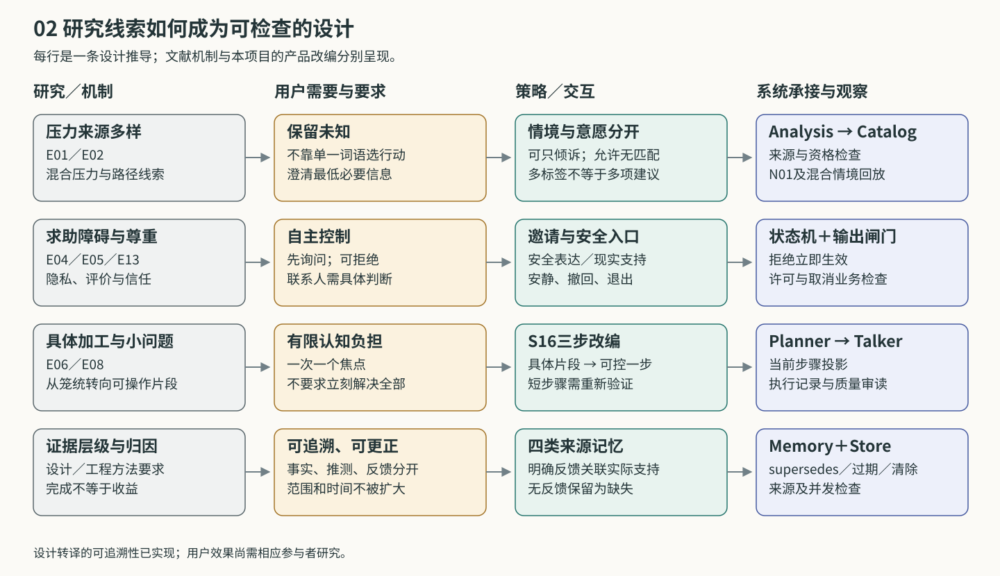

*图02．研究线索、设计要求和实现之间的对应。箭头表示设计推导，详细对应表见附录A。*

## 3. 支持内容与交互组织

### 3.1 一次对话可以停在哪里

系统允许用户停留在倾听与澄清阶段。开场、探索、安慰、许可、行动、收尾和安静，规定的是当前回应的范围；用户可以在探索中要求安静，在行动中停止，也可以在收尾后重新提出话题。练习与危机则有各自的运行模式。

这种交互需要不同模块共同完成。实时通路负责眼前的回应，后台根据新信息形成支持方向，安全通路独立判断风险，记忆服务保存以后仍适用的信息。后台完成一次评议后，结果先接受发布检查，供后续合法回合使用，不直接插播语音。图03给出了这些职责的关系。

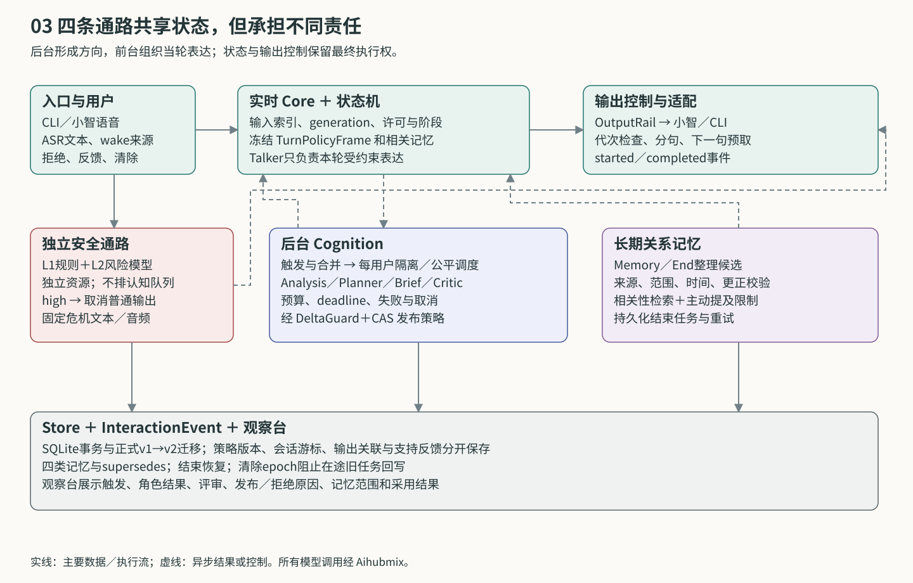

*图03．系统总图。前台读取当轮策略与记忆；后台异步形成候选；风险和取消可以改变输出权限。*

“安静”通常由一句简短确认开始，随后停止推进和追问，连接仍然保留。再次唤醒由适配器传入真实来源，不能从普通文本中的唤醒词推断。重新连接后可以读取适用记忆，旧会话的行动许可则不延续。是否在开场提起过去的事，还取决于来源、时间和用户允许的范围。

### 3.2 从通用原则到具体内容

倾听、准确表达和尊重意愿贯穿所有互动，由persona、阶段提示和输出护栏共同约束。策略卡处理更具体的问题，短练习执行固定脚本，风险响应另走独立通路。图04中这些层次各有用途，普通倾诉无需先选中某张卡。

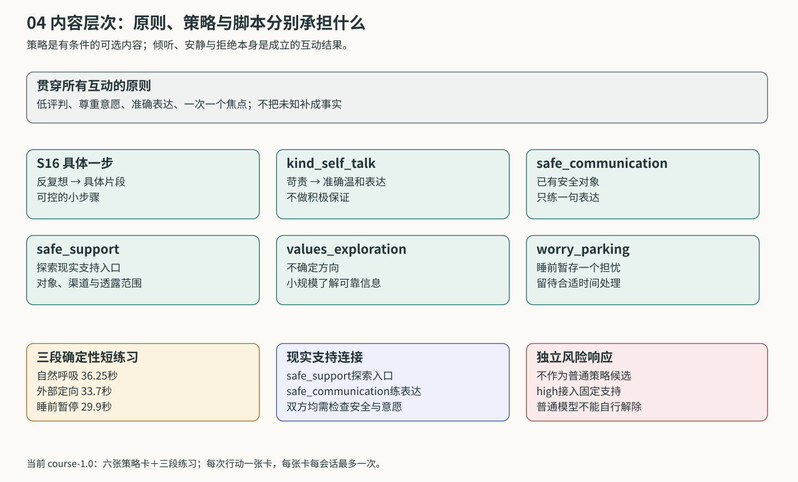

*图04．当前内容包中的六类策略、三段练习及独立风险响应。现实支持由安全表达和入口探索两张卡分别承接。*

策略目录先检查内容是否启用、本会话是否拒绝或已用到上限，以及情绪强度、准备度、必要情境与排除条件，再对合格条目排序。压力与路径只需任一目标侧匹配；中文关键词用于有限排序，最多向Planner提供少量候选。混合情境中仍只选择一个当前焦点，没有合适内容时继续倾听或澄清。

一次行动执行一张卡。六张卡各自限制每会话最多一次，通常三步，睡前暂存为两步，实际步数还受状态机总上限限制。结束或拒绝后不自动接着换卡；用户后来提出新的需要，可以重新经过资格与许可检查。这使行动保持有限，也给用户留下调整方向的空间。

### 3.3 邀请与同意之间

一个邀请先成为待输出提议，在收到服务端`started`回调后激活。用户明确同意、提议仍有效且存在合格内容，系统才进入行动。当前回调表示服务端开始执行，设备是否已播放到用户耳中尚无逐段ACK确认。

有时用户已同意“试一个办法”，后台却还没有选出卡片。系统会保留有期限的等待；若之后选中一段具体练习，还要说明练习并再次征求同意。换题、拒绝、强情绪、提议过期或其他控制变化，都可能终止这次邀请。

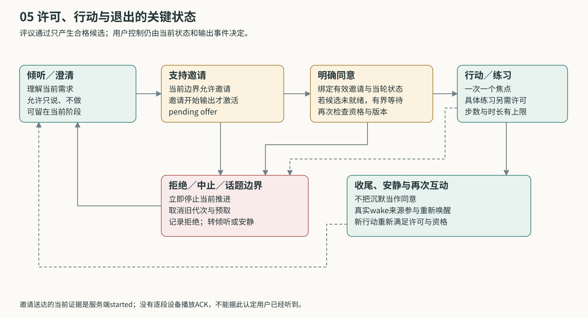

*图05．邀请激活、明确同意和执行是不同事件。拒绝与中止先在当前状态生效，后台随后重评。*

### 3.4 六类策略的共同约定

每张卡保存机制依据、最低必要信息、适用与排除条件、步骤、禁语、退出、跟进及反馈解释。Planner和Critic读取选择所需的摘要；Talker执行时只读取当前一步。Analysis提供有来源的情境，Catalog筛选，状态机决定能否进入行动，角色之间的交接见第4节。

六卡都排除高情绪强度和低行动准备度。用户说停、表示无用或不适、改为只想倾诉，或者出现安全信号时，系统退出当前行动。后续事项应来自用户明确提出的未来事件或允许再谈的内容，不索取行动承诺；结束任务仍需核对来源，单独一个“明天”不会形成提醒承诺。

反馈也有共同规则。执行完步骤只记录完成，明确表达的帮助或不适才与实际支持关联。负反馈阻止本会话再次推荐相应内容，并保存有范围的支持经历。下文各卡沿着问题、条件、过程和反馈展开；示例语句均为合成表达。

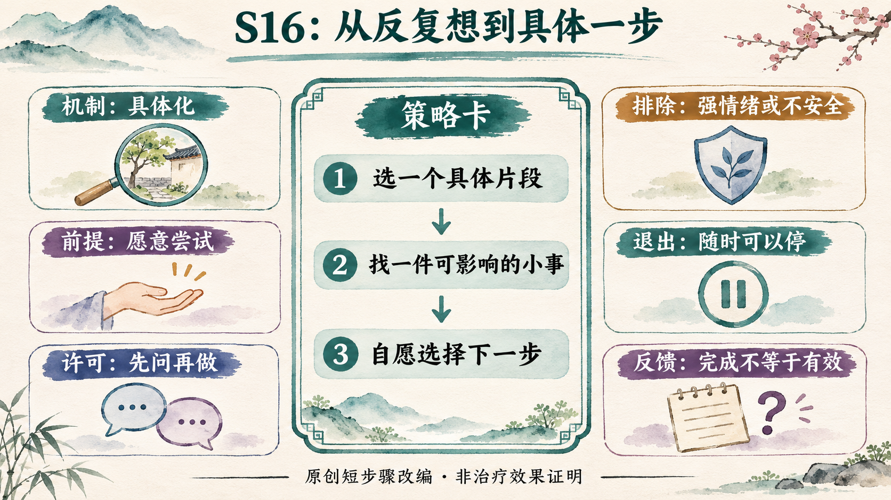

*图06．以S16为例，一张卡同时描述支持步骤和使用条件。生成图中的简要标签由正文与配置补充。*

### 3.5 从反复想转向具体的一步（S16）

S16用于用户愿意尝试、且能够讨论一个具体片段的学业困扰或反复想。它把“为什么我总是不行”缩小到眼前的事情，再找出自己可以影响的部分。具体加工实验与EASE的小问题组织方式提供了这一改编的依据（E06、E08）。最低信息是一件当前困扰的事，用户已说明时就沿着原话继续，不重新询问整个经过。

执行从一个片段开始。例如，“只看刚才卡住的那一处就好，暂时不用解决全部。”接着区分一件可以影响的小事，最后由用户决定是否选择最小下一步。个人无法控制的问题应当保留其现实限制，不能转写成“只要努力就能解决”。不安全关系和要求详细回忆创伤的情境排除此卡；“别想了去做就好了”“你又在钻牛角尖”也属于禁语。

这张卡的局部结果可以是说清一个片段，或选定一个小步骤。用户愿意行动不等于压力已经减轻；“刚才这样问有帮助”则能够关联到实际输出。若用户转而只想说一会儿，系统回到倾听，不紧接着推荐另一张相似卡。

### 3.6 把苛责换成准确温和的一句话（kind_self_talk）

kind_self_talk从用户已经说出的苛责内容出发，关注一次表现怎样被扩大成对整个人的评价。它合并了朋友视角、双重标准检查和温和自我对话，依据为完美主义担忧研究与青少年自我关怀试验（E07、E09）。使用前需要确认用户愿不愿意尝试另一种说法。

系统先承接这句评价，随后邀请用户形成一句对朋友也说得出口、同时符合事实的话。例如：“‘这次没达到目标’，会不会比‘我整个人都不行’更贴近事实？”用户可以改成自己的版本，也可以不用。表达应保持准确，不评价身材或能力高低，不要求接受“你就是最棒的”“你一点问题都没有”之类保证。

现实威胁、欺凌和不安全关系需要先处理处境，不能被解释成用户想法出了问题。若用户觉得改写空泛、被纠正，或者只是想被听见，系统停止改写。采用一句话只说明本次表达获得接受；拒绝也提供了适配信息，而不是需要争辩的错误。后续使用相关记忆，仍以用户主动谈起或允许跟进为条件。

### 3.7 练一句安全的表达（safe_communication）

这张卡用于用户希望向一个相对安全的人表达感受或请求。内容借鉴人际干预中的沟通分析与角色练习，并结合求助研究中的信任问题（E10、E05）。选择前至少要知道想对谁说什么，以及是否担心报复、泄露或伤害。Catalog要求明确的`safe_contact`条件；对象的身份本身不能替代这些信息。

用户同意后，先确认核心意思和合适时机，再根据原话拟一句感受与请求，最后由用户决定保留、改写或不用。例如，“刚才被打断时我有点难受，我想先讲完。”系统不猜对方动机，也不要求对质、原谅或和解。威胁、欺凌、缺少隐私空间和睡前情境排除此卡；补充了不安全信息时也应立即停止。

草拟、打算使用、已经发送和收到回应，是四种不同的事实。记忆只能在用户明确报告后记录后两者，系统也不能保证对方不会生气。若用户转向寻找其他现实支持，需要另一次判断与许可，不在拟句之后自动追加第二项行动。跟进限于用户愿意再谈的事项。

### 3.8 找到一个现实支持入口（safe_support）

safe_support帮助用户考虑愿意联系谁、通过什么方式、透露多少。求助调查、障碍综述与PFA中的连接原则构成其依据（E04、E05、E13）。它与安全表达分开保留，因为用户可能尚无合适联系人，当前任务正是寻找入口。

系统先确认是否愿意考虑现实支持，再了解一个主要顾虑：评价、隐私、负担或安全。随后由用户选择相对安全的人或渠道，愿意时再拟一句低负担的开口，只包含用户同意透露的内容。例如，“你希望对方先听你说，还是帮你找合适的支持？”渠道是否存在、是否可用仍需核实，尤其不能默认学校一定提供某项服务，也不许诺绝对保密。

睡前不推进这项行动，明确拒绝联系的人也不反复推荐。若候选对象都不安全，应保持支持，再依据情境讨论其他可信入口；高风险由独立通路处理。选择了入口或写出一句开口，并不代表已经联系。只有用户明确报告联系发生，系统才保存相应事实，后续也不会代发消息或声称已经通知他人。

### 3.9 找一个暂时想了解的方向（values_exploration）

面对未来迷茫，values_exploration帮助用户形成一个可以探索的问题。它借鉴中国高中生生涯课程中的探索与信息获取方式（E11），以压力研究提供情境参照（E01）。起点是用户提到的兴趣或困惑，不知道也可以保留未知。

执行时先选一件有一点兴趣或在意的事，再将其变成小问题；用户愿意继续时，选择相关从业者、可信老师或官方资料等信息来源。“现在不用决定一辈子，可以先弄清你对这件事好奇什么”，体现了这张卡的尺度。系统不做职业匹配评分，不从一次兴趣推断天赋，也不提供未经核查的政策或录取保证。

如果用户只想卸下焦虑、准备睡觉或暂时不愿规划，就停止探索。形成问题和决定暂缓都可以是当前选择，不能据此记录生涯困扰已经减轻。后续事项同样区分意图与事实：“想看看有没有讲座”不会被保存为讲座已经确定。

### 3.10 睡前把一件担心留待明天（worry_parking）

worry_parking在用户明确准备休息、又愿意留一句话时使用。睡前书写实验和睡眠关联研究提供了机制启发（E12、E02），具体改编则收缩为两步：确认一件留待以后处理的事，复述用户愿意留下的那句话，然后收尾。

“这件事先留在这里，今晚不用把它解决完”是合成示例。过程不扩展成待办清单，用户拒绝记录时就直接结束，不再追问明天怎样安排。结构化条件要求睡前情境，排除不安全关系、强情绪和低准备度。

本卡没有引入睡眠限制、刺激控制或其他失眠治疗规则，也不保证入睡。暂存、拒绝和结束都可能符合用户此刻的意图；是否睡得更好需要另外的反馈或测量。它与固定bedtime练习的区别在于，前者回应用户的一句话，后者播放预先定义的短暂停脚本。

### 3.11 三段短练习与内容取舍

短练习由固定文本和句后停顿组成，播放时不让Talker扩写。它们有独立邀请和明确同意；新输入、中止或风险接管会停止当前执行。中断后即便保留恢复线索，也要重新邀请。

自然呼吸小暂停（`breathing_60s`）允许睁眼和选择舒适姿势，只留意一次自然呼吸，不加深、不数拍；身体聚焦不适时不进入或立即停止。它以E16为练习证据背景，当前音频连同停顿为36.25秒，历史ID中的60s并非现版时长。

“看看身边一样东西”（`grounding`）将注意力短暂放到安全环境中的普通物件及一种颜色，无需回答。对脚下或椅子支撑的注意可以跳过。现版时长为33.7秒，来源登记为E13的支持原则，具体感官脚本尚无直接效果验证。

睡前短暂停（`bedtime`）从舒适姿势和自然呼吸开始，提示担心可以暂不处理，然后结束对话。它要求明确睡前且可以安静休息，排除不安全和身体聚焦不适，现版时长29.9秒。E02、E12提供关联及机制背景。

三段练习均受90秒总长限制。以上时长来自当前部署音频，重新生成声音后需重测；播放完成与主观帮助分别记录。

六类策略的形成也包含合并与排除。具体加工和可控小步合入S16，朋友视角与温和自我对话合并，生涯叙事收缩为有限探索。安全表达与现实支持入口因前提不同而分开；社交小尝试纳入后者。完整CBT-I、IPT-A、专业暴露、自动诊断和积极宣言未进入内容目录。早期缺失的“A线策略全文”没有被补写成原文，新语义ID也没有冒充历史S03—S19。

内容发布与每次运行中的评议分别进行。当前`course-1.0`登记来源、Codex自动内容核查、文件摘要和行为证据；demo进一步检查内容及提示词摘要、真实回放回执、音频与文本／声音绑定和时长。六卡、三练习与固定危机内容共十项，使用`course-release-1`回执，本地准备24段固定音频。这是课程内容与工程准入，尚无人工临床审核。修改与准备流程见[内容说明](../CONTENT.md)。

## 4. 后台协作如何形成支持方向

### 4.1 分析、规划与评审

一次支持选择可能在几个地方出错：误解用户处境，选择了不合适的内容，遗漏了拒绝或话题边界，或者在表达时增加了未经许可的建议。后台分工让这些判断分别留下结果，便于定位问题。它也使实时Talker能够先回应，而不等待完整分析。

Analysis读取有限对话、适用记忆、状态与交互事件，形成有来源的情境描述，包括事实、假设、意愿、压力与路径线索、必要条件和待澄清问题。Planner结合分析、原始证据、合格内容摘要、边界及反馈，提出支持方向和表达指引。两者都不能授予行动许可或解除危机。

完整评议还引入独立Brief和Critic。Brief只看原始历史、状态、记忆与反馈，不看Analysis结论、卡片目录或Planner候选，先提出值得关注的需求和反证。Critic再依据这份Brief、原始证据、分析和合格目录，评审一个确切版本的候选。结果可以是批准、要求修订、拒绝或信息不足，不能直接改写计划或发声。

这里的“独立”指输入与职责隔离。部分角色使用同一基础模型，仍可能共享错误。项目尚无比较实验说明这套多角色协议优于单模型；目前采用它，是为了使支持选择和检查过程可观察，并把复杂判断放到实时回应之外。

### 4.2 日常更新与完整评议

普通输入并不都启动整套评议。默认每四个用户轮次可以触发一次routine，由Analysis和Planner更新非行动方向，如倾听、澄清、安慰、反映或安静。它不产生行动候选，也不标记为已独立评审。

明确求助、缺卡、拒绝、纠正、边界变化、可归因反馈、哭声或情绪事件，以及risk watch，可以触发deliberation。Analysis与Brief先并行运行，Planner形成V1，再由Critic评审；只有需要修订时才形成V2，并对V2复核。图07显示了两种流程。哭声只说明需要重新理解情境，不自动使呼吸练习变得合适。

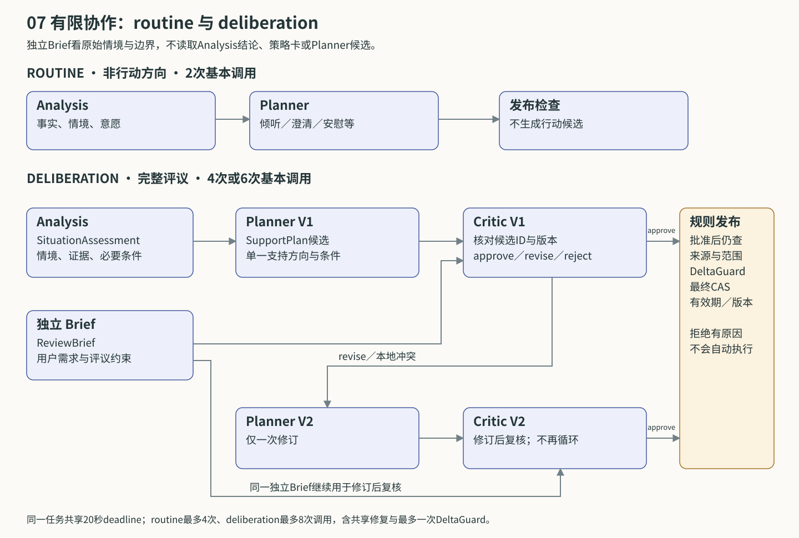

*图07．routine的两次基本调用与deliberation的四次或六次基本调用。独立Brief参与首次评审和修订后复核。*

以“我只想说，不要给建议”为例，Brief应关注建议边界，Planner可以选择倾听。如果候选仍带有行动，或者必要问题与`no_topic_probe`冲突，Critic和本地逻辑检查会要求修订或拒绝。即使Critic批准了一个内部矛盾的候选，本地检查仍能拦截。V2缺少复核、评审返回错误版本，或仍存在阻断问题时，计划均不能发布。

### 4.3 从角色结果到当轮表达

情境分析、计划候选、评审意见和已发布计划是不同产物。系统在发布时补齐身份、时间、版本、核对游标和评审关联，之后才能形成供前台读取的SupportPlan。当轮开始时，Core再冻结允许采用的TurnPolicyFrame，将当前卡的当前一步、必要边界和相关记忆交给Talker。后台稍后完成的新结果不会改写已经开始的这一轮。

这种分工使观察台能够分别展示Planner建议了什么、Critic批准哪一版、发布是否被新输入阻止，以及下一轮是否实际采用。保存的是结构化结果和简短依据，而非依靠展示长篇推理来说明判断质量。各契约的输入、输出与权限集中列在附录B。

Memory和End另行整理长期信息。当前真实Analysis调用已通过schema投影去掉可选记忆候选字段，避免重复整理和上下文膨胀；明确边界与姓名仍由Core及时处理。Memory提出记忆候选，End根据固定结束游标整理总结、记忆和有来源的后续事项，再交给程序校验。

### 4.4 调度与资源限制

同一用户最多有一个活动认知任务，任务内部允许Analysis和Brief并行。尚未运行的策略任务合并触发原因，较强任务可以覆盖待执行的routine，避免每句话积压一套旧讨论。不同用户通过有界队列公平分配机会；结束整理、边界或拒绝修复、明确求助、普通周期与记忆整理具有不同优先级。风险检测使用独立资源。

单任务共用20秒deadline，并受调用次数、输出Token和总Token预算限制。routine最多四次调用，deliberation最多八次，其中包含最多一次共享格式／来源修复和最多一次DeltaGuard；基本流程之外的检查也消耗这份预算。剩余额度不足时就停止请求。同步HTTP如果尚未退出，资源槽保持占用，防止逻辑取消后继续无界发起调用。

前台模型、风险模型与后台资源分离，后台超时或被拒绝时，当前轮仍可作符合边界的简短回应。任务保留超时、拒绝、取消、过期或部分提交的状态，供观察台和恢复流程使用。当前经Aihubmix调用qwen-plus承担Analysis／Planner，qwen-flash承担Brief／Critic／Delta及Talker／Risk，gpt-4.1-mini承担Memory／End；配置来自接口与延迟探针，未进行多模型排名。

## 5. 跨会话记忆与反馈

### 5.1 哪些信息值得留下

记忆主要解决重复说明和边界延续的问题。用户下次回来时，系统可以使用正确称呼、知道一项明确计划仍在等待结果，并遵守“以后不要主动问考试”这样的要求。保存的范围因此取决于信息用途和来源，而非尽量积累对话内容。

当前有四类记忆。事实与偏好保存明确称呼及有依据的长期偏好；事件记忆记录已发生或明确计划的事情，并保留时间；交互边界约束能问什么、能建议什么以及持续多久；支持经历把实际使用的内容版本、步骤与用户明确反馈联系起来。一次拒绝可以说明当次不适配，不能直接成为长期人格偏好。

每项候选需引用同一用户可核验的原始输入、有效记忆或交互事件。引用ID存在还不够，提供引文时还要逐字匹配，来源类型也必须正确。例如，输出ID不能替代用户反馈事件ID。契约区分用户陈述、系统观测、假设和未核验旧记录；当前MemoryService拒绝把后两者写成新的长期事实，边界和偏好还要求明确用户证据。旧数据中的未核验标识继续保留。

### 5.2 时间、范围与提及方式

一条记忆可以适用于当轮、当前话题、当前会话、截至某个时间，或长期。事件发生时间、记录时间和有效期分别保存，以免把“上周发生过”误当成“现在仍然如此”。“今天别问考试”按本地日界到期，“以后别主动问考试”则可长期生效，直到用户更改。

读取时先筛选同一用户、有效状态、时间与范围，再用中文字符二元组和英文词重叠衡量相关性，同时考虑重要性、记录距今的时间和近期重复使用。交互边界单独保留，避免被普通相关性排序挤出。图08展示了写入和读取的先后关系。

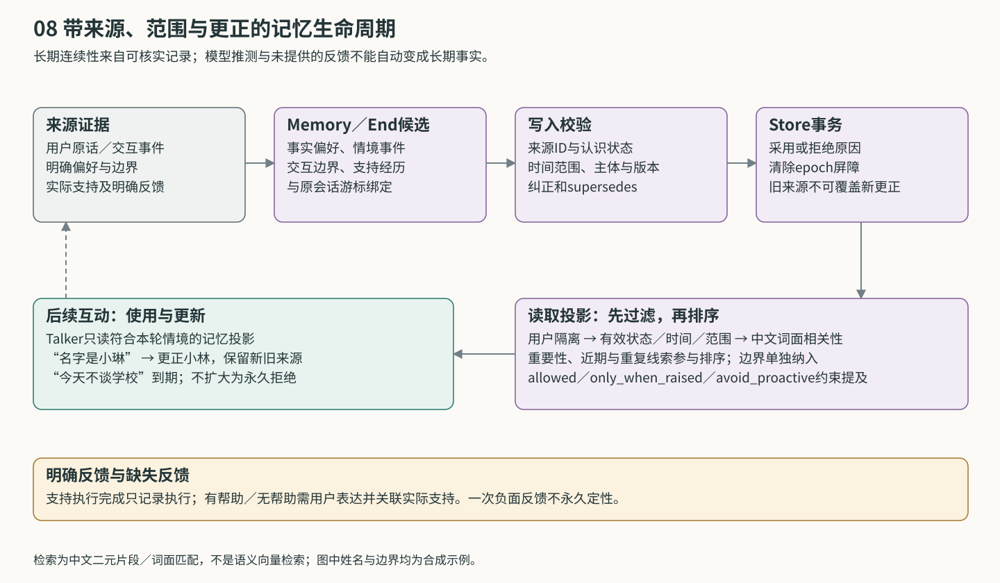

*图08．记忆在写入前核对来源，在使用前核对范围和相关性；更正保留替代关系，并阻止旧候选重新覆盖。*

检索出的内容还受提及规则约束：`allowed`允许在合适语境使用，`only_when_raised`要求用户已谈到相关内容，`avoid_proactive`限制主动提起。敏感信息也要求当前话题已触及。有限Token预算优先保留边界，减少普通记忆和指引；边界过多时采用保守规则并集，投影仍保持完整结构。

这套检索使用词面匹配，可能漏掉同义表达、含蓄指代和较远关联。边界解析也依赖有限中文模式，目标不清时会保守保护当前情境，既可能漏识别，也可能扩大限制。用户主动谈起一个话题，允许系统在范围内回应，但并不自动撤销长期“不主动追问”的要求。

### 5.3 更正与局部例外

用户更正姓名时，旧值先退出当前使用，新记录引用新的原话，并保存版本与`supersedes_id`。来源游标使系统能够判断先后：旧会话的结束任务即使晚到，也不能用较早的证据把“小琳”重新写成“小林”。依赖这条记忆的支持计划也要核对版本。

边界允许较窄例外。例如，长期“不主动问考试”与当天“今天可以问我考试进展”可以共存。系统用同目标的较新例外遮蔽相应限制，例外到期后，长期边界继续生效。原记录因此无需删除，用户也能继续更改它；是否识别为同一目标仍受当前规则能力限制。

清除信息时，Core先建立用户清除屏障并更新执行代次，取消任务与输出，等待有界在途工作后再事务删除。迟到的模型响应无法重新写回已清除内容。数据库清除、历史备份、开发证据和外部服务保留有不同处理范围，具体操作见运行文档。

### 5.4 用户反馈怎样影响后续选择

服务端记录一次支持已经开始或完成，用户表达是否觉得有帮助，两者来自不同事件。系统优先将明确反馈关联到本会话最近已开始或完成、且早于当前输入的输出，再携带其内容类型、ID、版本和步骤保存支持经历。

“刚才这样问有帮助”可以提供具体归因；单独一句“好多了”可以作为积极表达保留，但不足以认定某张卡有效。当前方法依赖明确句式和近邻输出，尚不具备全面的指代消解。重复回调以幂等键去重，含糊和缺失反馈均不补成收益。

明确负反馈把相关卡或练习加入本会话拒绝集合。支持经历可以跨会话保存，默认只在相关话题被提出时使用，不直接形成永久黑名单。近期同一可归因目标在四个用户轮次内出现两次明确失败，会触发更强重评；当前行为在第一次拒绝时已经停止。

## 6. 对话持续变化时的执行控制

### 6.1 分别判断输出、策略和记忆

后台需要数秒完成分析，而用户可能继续说话。新输入要求上一轮输出停止，却未必推翻后台已经形成的理解。系统因此分别判断几种产物的有效性：输出绑定当前代次，支持计划绑定已核对的情境与版本，记忆依赖来源与范围，结束总结绑定原会话的结束游标。

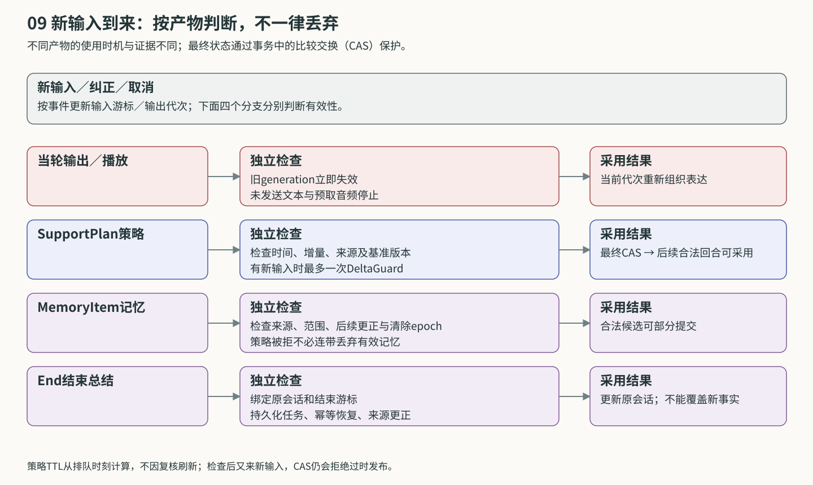

*图09．一次新输入对不同产物的影响。旧输出取消，其他产物按各自条件决定是否保留。*

每次新输入递增`generation`，旧文本、播放计划和预取音频失效。若用户只是继续讲同一件事，后台计划可以通过DeltaGuard核对新增输入；若有拒绝、纠正、换题或边界变化，则还需满足相应控制版本。播放计划使用原有`active_plan_id`，支持方向另用`active_support_plan_id`保存，避免混用寿命不同的对象。

DeltaGuard最多核对一次。兼容结果只推进实际检查到的输入游标，不改变计划语义或有效期；不兼容、不确定或超时会阻止发布。核对结束后仍可能有新输入，因此最终发布还在用户锁、会话锁和数据库事务内比较当前输入游标与计划基线版本。CAS不相等时拒绝旧提交，解决检查与写入之间再次变化的竞态。

计划默认限制为排队起120秒、最多四个新增用户轮次，不因读取或复核续期。普通新输入还未核对时，前台只使用通用倾听方向，暂不沿用旧行动邀请或主动引出敏感旧话题。已经冻结的当轮上下文不受后台新发布结果影响。

### 6.2 部分提交与结束恢复

计划过期时，一条独立、有来源且未被更正的记忆仍可能有效。统一发布机制允许只提交合法记忆，将任务记为partial，并记录拒绝其他产物的原因。当前真实Analysis已收窄记忆输出，主要记忆来自显式交互及Memory／End；分产物判断仍保留在发布协议和测试中。

SQLite保存任务、角色运行、计划、当轮策略、交互事件、记忆和来源。正式v1→v2升级先做一致备份，再事务迁移，重复启动不重复导入。课程增量字段主要进入已有JSON契约，数据库版本仍为2；一个数据库由一个Core进程持有。

结束整理使用持久化任务和固定`final_turn_id`。重启可以恢复未完成任务，明确失败保留状态并支持显式重试。它只整理原会话，不修改新会话的当前策略，也不能覆盖后来的记忆更正。迁移、回滚、结束恢复与清除竞态的检查列在[V2验收矩阵](../V2_IMPLEMENTATION_STATUS.md)。

### 6.3 风险检测与输出接管

风险通路由本地L1词表和独立L2模型组成，不在认知任务队列中等待。Talker可以同时生成，第一段内容则经过有界输出闸门：默认从输入起最多等待600毫秒风险结果，而非每句额外停顿600毫秒。到期后仍允许输出时可以先放行，迟到high继续拥有接管权。

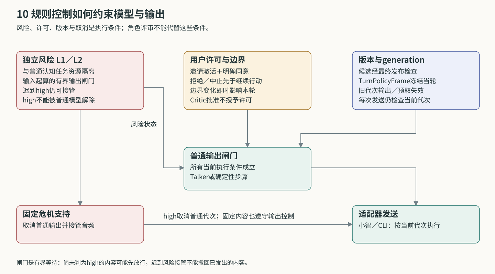

*图10．风险状态、用户许可和输出代次共同约束执行；角色评审通过后仍须满足这些条件。*

high使普通代次失效，取消普通任务并切入固定危机支持。Planner和Critic不能解除危机，后续一句平静表述也不自动解除。风险记录留在观察台，默认没有配置对外通知。由于闸门有等待上限，接管只能停止后续发送，不能撤回已经发出的内容。

许可与风险分别回答两个问题：用户是否同意这项行动，当前是否允许普通通路继续。已有许可不能覆盖风险接管，risk none也不能替代同意。输出护栏继续检查禁语、越权状态、无依据保证，以及已观察到的未许可建议句式；有限规则之外的措辞问题仍靠真实回放审读发现。

### 6.4 语音等待与取消

小智输入经Opus解码和本地SenseVoice识别进入Core；Talker输出流式分句，再经Aihubmix取得完整WAV，编码为Opus并按节奏发送。第一句文本已经形成时，用户还可能在等待合成和传输。因此测试分别记录首token、首句、TTS开始与完成、编码、首包发送和客户端接收。

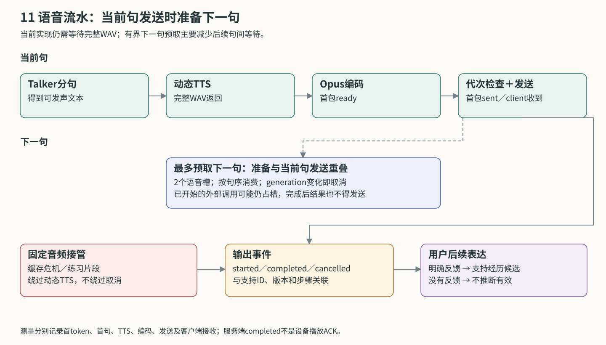

*图11．当前句发送与下一句准备可以重叠。固定音频绕过动态TTS，两条路径都检查代次和取消。*

现有优化包括直接输出正文、缩短第一句、压缩角色上下文、资源隔离和有界下一句预取。两个动态语音槽允许当前句与下一句的准备重叠，按原序消费，避免无限预生成。当前TTS仍等待完整文件，因此预取主要改善后续句间等待，不能消除第一句合成时间。

新输入或abort更新generation，取消旧输出和预取。合成前后、编码与发送边界都核对有效性；旧HTTP即使继续运行，返回的音频也不能重新进入发送。预取完成本身不激活邀请。危机与练习片段提前准备，检查文本、声音、文件hash和总时长，接管时无需等待动态TTS。

当前`started`与`completed`来自服务端执行或发送估计；契约预留的`device_ack`尚未接入逐段设备确认。服务端开始邀请后才激活提议，后续用户明确反馈再用于归因。本机探针已检查abort后无旧binary继续到达，但设备缓冲何时清空、扬声器何时停声仍待真机测量。

小智保留六处核心hook，将连接、输入、输出、结束、abort和真实wake来源衔接到Core。课程升级另有独立访问凭据补丁，由服务器映射用户身份。公开项目站展示内容与架构，不直接连接携带密钥的后端；联调方式见[小智交接说明](../XIAOZHI_HANDOFF.md)。

## 7. 三个合成交互过程

以下案例将前述机制放在同一次互动中说明。语句是合成示例，不是参与者或实测逐字转录；后台结果仍需按实际时间形成。

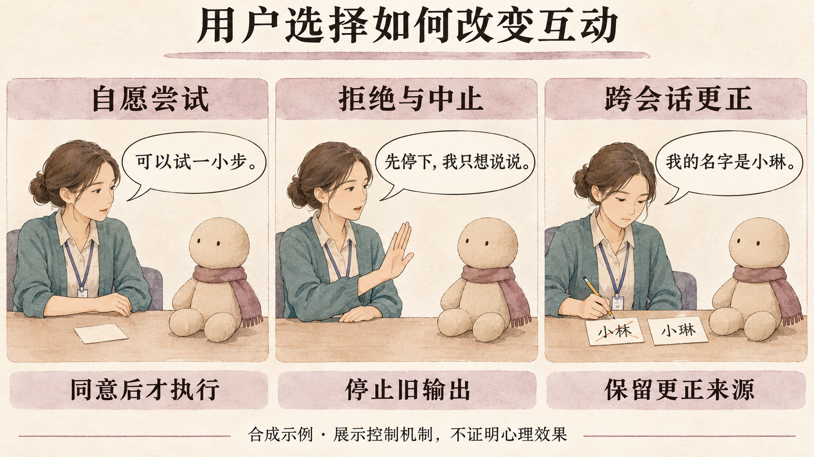

*图12．自愿尝试、中止与跨会话更正。三个场景展示用户选择带来的控制变化。*

### 7.1 愿意尝试一个小步骤

用户说：“刚才那道题一直做错，我反复想，想找个办法。”Core登记输入、取消旧代次，并触发求助评议；风险检测独立运行，前台可以先提出固定许可邀请。Analysis保留学业、反复想和尝试意愿，Catalog据条件筛选S16。缺少联系人安全信息时，人际表达卡不会因此进入行动。

Brief关注是否把做错题扩大为人格判断。Planner提出S16，Critic核对候选版本，随后程序检查来源、版本和新增输入。邀请已经开始输出，用户又明确同意，合格策略才与当前许可共同进入action；如果候选尚未就绪，则有期限等待。

Talker此时只读当前步骤。用户已经说明某处计算问题，就从该处继续，不重问整个经过。具体输出关联S16、`course-1.0`及步骤。用户若说“刚才这样问有帮助，我知道卡在哪里了”，系统将其关联到最近实际输出，写入支持经历。用户决定停在这里后，结束任务整理有来源内容；没有明确未来事项，就不生成跟进。

### 7.2 觉得无用并要求停下

kind_self_talk执行中，用户说：“这个办法没帮助，先停下，我只想说说。”Core先撤回提议、退出行动并更新代次，Interactions记录反馈，将该卡加入本会话拒绝集合。后台合并拒绝与反馈触发，随后重评倾听方向。

这时旧Talker或预取音频可能才返回，但输出闸门会因代次不匹配丢弃它们。支持经历保留的是某版本某步骤收到负反馈，供后续相关判断使用。对于已被话题边界阻止的邀请，当前实现直接使用`boundary_hold`确认，避免再生成一条替代建议。

若中止的是grounding，ExercisePlayer和OutputPort停止后续脚本及旧音频，并记录interrupted。中断本身不说明用户状态变差，也不自动触发呼吸练习。是否重新尝试需要新的具体邀请与意愿。

### 7.3 下次回来时更正与边界仍然有效

会话A中，用户先说“我叫小林”，随后更正为“刚才说错了，我的名字是小琳”。Core使旧称呼退出使用，以新原话建立后继记录。旧后台任务即使晚到，也不能把名字改回去。

同一会话里，用户说“今天别问考试”，又补充“以后别主动问考试”。前者按本地日界到期，后者长期限制主动追问。一次可归因的“这个办法没帮助”则保存为支持经历，并更新本会话拒绝集合，三种信息各有自己的范围。

会话B真实唤醒后，系统读取同一用户的适用记忆，可以使用正确称呼，开场不主动问考试，也不恢复旧行动许可。若用户说“今天可以问我考试进展”，当天例外在对应目标上遮蔽长期限制；到期后，长期边界继续适用。用户愿意谈考试，仍需另行决定是否接受某项行动。

这一组合示例对应姓名更正、范围、例外和跨会话读取等已有机制。其证据来自N07真实回放及独立范围／更正测试，没有把组合后的所有台词当作一段已执行记录。

## 8. 验证结果与尚待回答的问题

### 8.1 工程检查与真实接口

现有结果来自2026-11-04课程升级验收。152项离线检查通过，另有三项在线检查未纳入该次离线运行；Ruff与格式检查同时完成。测试使用可控时钟、屏障和故障注入，检查许可、重复、取消、过期、部分提交、来源、迁移、重启与清除等业务结果。V2-01—V2-24的逐项证据可在[验收矩阵](../V2_IMPLEMENTATION_STATUS.md)查阅。

真实接口验收覆盖Aihubmix各角色、CLI、观察台、小智WebSocket／Opus／ASR，以及隔离环境中的wheel资源和v1迁移。它们确认默认执行链与安装资源能够运行。设备音质、扬声器首响和实际停声尚需硬件联调。此前96项检查和40次语音是历史批次，本文采用[最新验证报告](../VALIDATION.md)及[合成汇总](../autonomous-upgrade/VALIDATION_SUMMARY.json)中的结果。

### 8.2 多轮回放发现的问题

固定场景集`course-quality-1`包含T01—T09九段目标覆盖，以及N01—N08八段完整目录自然选择。前一组限制候选目录，以确保启用内容获得执行机会；后一组观察系统在完整目录中的选择。回放器模拟服务端执行，不合成音频，因而练习逻辑与音频另行检查。

两次完整回放各有73个输入。第一批执行了8/9目标，T04未执行；第二批达到9/9，但仍有语言问题及N08结束捕获的驱动错误。第二批共76个后台任务：61 completed、4 partial、8 rejected、2 timed_out、1 expired；205条角色记录中197 completed、6 schema_error、2 timed_out。rejected可能表示候选被有效拦截，需要结合原因判断。之后按问题进行了8+1+2+1段定点补测，原始失败均保留。

若干问题出在语言理解与状态控制的交界。“不想要办法”曾被求助子串误匹配，后来调整为拒绝优先，N01补测转为倾听；转述“愿不愿意”曾被当作撤回，修正后T04保持当前行动。句后闭引号被单独发声的问题，则通过流式尾部排版字符处理修正，T03补测没有依靠等待下一token来延后首句。

另一些问题涉及模型表达和来源。T03／T05中出现计划被写成已发生、无依据保证，修复补充了计划与事实的区分及针对已观察问题的护栏。Memory／End曾引用不存在的事件ID，来源校验现在进入同一有界修复预算，错误候选无法入库，T03后续补测结束任务完成。N04中，边界阻止邀请后Talker仍给出泛化建议，修复将该分支改为固定确认；final6实际命中该分支，但仍出现一次后台超时。

当前仍观察到概括性肯定、重复询问感受、学校支持可用性表述偏确定，以及边界目标不清时保守阻止行动。目标内容全部获得执行机会，与每句表达质量合格是不同结果。逐段记录见[质量审读](../autonomous-upgrade/QUALITY_REVIEW.md)；T01—T06分别承接六卡执行，T02还覆盖退出与负反馈，T04检查版本化反馈，N02观察自然选择，N03／N05涉及不安全与依赖表达，N07检查跨会话记忆。

### 8.3 动态语音与后台耗时

最终批次`voice-final2`使用单客户端顺序输入，后台正常开启，没有同时运行质量回放。30次普通动态语音均成功，无回退、失败或超时；共生成31句，均未命中固定音频缓存。21/21后台角色和8/8认知任务完成，结束任务为done。

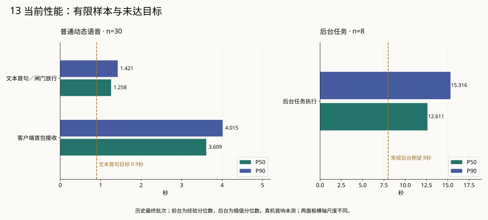

*图13．最终批次的P50／P90。语音样本n=30，后台任务n=8，真机首响未测。两面板横轴尺度不同。*

| 指标 | 样本数 | P50 | P90 |
| --- | ---: | ---: | ---: |
| 文本首token | 30 | 1.188秒 | 1.359秒 |
| 文本首句／闸门放行 | 30 | 1.258秒 | 1.421秒 |
| TTS开始（自输入计） | 30 | 1.273秒 | 1.421秒 |
| TTS完成（自输入计） | 30 | 3.539秒 | 3.937秒 |
| Opus首包ready／sent | 30 | 3.586秒 | 3.984秒 |
| 客户端首包接收 | 30 | 3.609秒 | 4.015秒 |
| 服务端发送完成 | 30 | 9.273秒 | 11.031秒 |
| TTS本身（逐请求差值） | 30 | 2.266秒 | 2.583秒 |
| 编码到ready（逐请求差值） | 30 | 0.047秒 | 0.065秒 |
| 后台任务执行 | 8 | 12.611秒 | 15.316秒 |

文本首句P50为1.258秒、P90为1.421秒，仍高于900毫秒目标；后台任务P50为12.611秒、P90为15.316秒，也未稳定达到常规8秒期望。客户端首包接收P50为3.609秒，不能替代1.8秒真机首响目标的测量。当前首句等待主要受外部文本生成和完整WAV合成影响，下一句预取主要作用于句间等待。

表中前七项沿用bench经验分位数，派生时长与后台采用插值分位数。TTS和编码时长由逐请求差值统计；不能将两个里程碑的分位数直接相减。不同历史批次同时包含模型、内容和故障修复变化，也不足以作为控制变量实验来估计优化收益。

该语音批次有81条provider记录，合计输入73521、输出5681 Token；TTS字符费用和账单金额未估计。真实多轮第二批另计442918输入、35880输出Token，含五条保守estimated记录。两批与调试调用分别统计，以保留各自成本和失败分母。

本机小智探针还验证了唤醒、动态回应、固定危机、abort后无旧音频帧、重连和真实Opus／SenseVoice输入。固定缓存接管的时延单独记录，不混入普通动态结果。设备缓冲清空、麦克风和按钮行为仍待硬件测量。

### 8.4 研究解释与后续评价

现有证据支持系统已实现一套可运行、可检查的支持流程：内容有适用条件，支持选择经过评议，行动需要许可，输出可以取消，记忆保留来源与更正关系。确定性测试覆盖了所设计的竞态和恢复情形，真实回放则揭示了接口及语言层面的具体缺陷。

用户是否因此更愿意表达、觉得支持恰当，或在压力、睡眠与求助行为上发生变化，目前还没有研究结果。文献转译涉及地区与年龄差异、成人书写到语音的形式变化，以及完整人工课程到短步骤的剂量变化。系统层面也保留有限中文规则、词面检索、近邻反馈归因、多角色共享错误和schema合法但内容不适配等限制。

后续评价需要直接观察用户怎样理解拒绝与安静控制，什么时候认为记忆恰当或冒犯，现实支持邀请是否清楚且出现得合时，以及语音等待和打断怎样影响使用。正式研究应根据参与者设计流程与测量；若涉及真实未成年人，还需相应的研究与保护安排。当前工程记录可以帮助选定情境和暴露故障，效果判断则应由后续参与者证据回答。

## 附录A　设计要求与实现对应

下表供查阅研究、内容与工程检查之间的关系。D1—D5主要由研究与内容设计共同形成；D6—D8还包含数据一致性、可审计性和资源约束等工程要求。

| 设计要求 | 研究发现／机制与项目解释 | 内容或交互选择 | 系统承接 | 可观察证据 |
| --- | --- | --- | --- | --- |
| D1 区分事实、意愿与推测 | 压力和路径具有异质性；同一词语不能决定需求（E01、E02） | 混合标签、未知保留、只澄清必要信息 | Analysis契约、来源校验 | N01混合压力；分类与无匹配检查 |
| D2 支持可以被拒绝 | 求助障碍和尊重意愿原则启发用户控制（E05、E13） | 倾诉、安静、撤回都可成立 | StateMachine、Interactions、OutputRail | 拒绝当轮生效；N01/N04修复与补测 |
| D3 行动具体且有限 | 具体加工与小问题机制（E06、E08） | 一次一个焦点、当前一步 | 六策略协议、Talker步骤投影 | T01—T06实际执行及退出 |
| D4 现实支持需检查对象 | 求助来源多样，身份不等于安全（E04、E05） | 区分安全表达和寻找入口 | StrategyCatalog条件、Critic | unsafe_relationship排除；T03/T04/N03 |
| D5 内容与选择可追溯 | 机制借鉴与产品改编需要区分 | 版本、来源ID、排除与反例 | 内容准入、SupportReference、看板 | hash过期拒绝；输出关联策略版本 |
| D6 连续性不能固化误记 | 对长期互动的工程要求，而非文献效果结论 | 来源、时间、范围、更正 | MemoryService、Store | N07；更正、过期与清除竞态测试 |
| D7 复杂分析不阻塞回应 | 语音交互与后台职责分离的工程判断 | 前台短回应、后台事件触发 | Core、Scheduler、独立执行槽 | 阻塞后台仍能回应；分段时延记录 |
| D8 完成与收益分开 | 研究证据层级及可归因性要求 | 记录执行、明确反馈、缺测 | InteractionEvent、支持经历 | completed不生成积极收益记忆 |

## 附录B　角色契约与版本说明

### 角色读取与产物

| 角色／服务 | 读取的信息 | 形成的产物 | 交接及权限边界 |
| --- | --- | --- | --- |
| Analysis 情境分析 | 有限历史、适用记忆、当前状态和交互事件 | SituationAssessment：事实、假设、意愿、压力／路径、情境条件、必要问题 | 引用用户来源；不回应、不批准行动、不解除危机 |
| Planner 策略规划 | 已校验分析、原始证据、过滤后的卡／练习摘要、边界和反馈 | PlanCandidate：目标、表达指引、必要问题、候选及避免行为 | 不能造卡或授予许可；修订仅处理必要变化 |
| 独立Brief | 原始历史、状态、记忆和反馈；不含Analysis结论、卡片目录或候选 | ReviewBrief：需检查的关注点与反证 | 完整评议中先形成独立检查角度，不提出支持方案 |
| Critic 评审 | 原始证据、Analysis、Brief、确切候选版本及相同合格目录 | ReviewResult：approve／revise／reject／insufficient_information | 绑定候选ID与版本；不能直接改写或发布 |
| DeltaGuard 增量核对 | 待发布计划和分析截止点之后的新输入 | compatible／invalidate／uncertain及依据 | 只核对兼容性，不延长计划寿命，不新建许可 |
| Talker 实时表达 | 当前输入、有限对话、本轮冻结策略、记忆、当前卡的当前一步 | 简短可说正文，流式分句 | 不调度其他角色，不自行转换阶段或添加行动 |
| Memory 整理 | 有限原始证据、已有适用记忆、明确反馈 | Consolidation中的记忆候选 | 提议写入，MemoryService校验来源、范围和冲突 |
| End 结束处理 | 固定结束游标内的证据、记忆及反馈 | 总结、记忆候选、有依据的后续事项 | 由durable end task驱动；不修改新会话的当前计划 |

SituationAssessment保存情境描述，PlanCandidate保存候选，SupportPlan是经程序补齐身份、版本和游标后的发布对象。ReviewBrief提供评议关注点，ReviewResult绑定候选版本；TurnPolicyFrame冻结当轮允许采用的内容，InteractionEvent记录执行或明确表达的事件，MemoryItem承载范围记忆，CognitiveJob记录任务预算、状态和分产物结果。

### 历史材料与当前实现

| 历史表述／容易混淆之处 | 当前事实 | 对本文的处理 |
| --- | --- | --- |
| 单个Reasoner负责后台 | 默认development采用Cognition有界多角色协议，旧Reasoner保留兼容／历史 | 以新角色交接解释，不把旧消费者写成并行权威 |
| 只有S16夹具、危机与练习draft | 六卡、三练习、固定危机course-1.0已核查并有课程回执 | 逐卡展开当前内容，保留改编限制 |
| 必须17张正式卡及人工签字 | 新课程任务采用可追溯自动核查与工程／真实回放准入 | 不把Codex核查写成人工或临床审核 |
| Talker必须等待标签输出 | 当前默认直接生成正文，兼容旧标签并检查越权 | 区分内容表达和服务端状态权威 |
| Analysis契约包含记忆候选 | 当前真实schema投影排除相关输出，Memory／End承担整理 | 不以可选字段推断实际角色工作 |
| “一次一张卡”理解为全会话一张 | 一次行动单卡；每卡本会话最多一次；新行动另需许可 | 明确不同层级的次数与切换语义 |
| v2带来的字段都需要新数据库版本 | 正式数据库迁移为v1→v2，课程增量主要进入已有JSON契约 | 分开数据库结构、内容版本和模型配置 |
| 六处小智补丁等于全部补丁 | 六核心hook保留，另有access.patch鉴权 | 介绍职责，不把鉴权算作旧六hook之一 |
| completed等于播放完或有帮助 | 当前为服务端执行证据，没有逐段设备ACK | 与设备首响和用户反馈分别表述 |
| 历史96项检查／旧40次语音 | 最新已报告152项与最终30次动态语音，其他批次单列 | 本文使用最新有效批次，不合并不兼容统计 |

本说明依据实现基线`c33b50b`、后端v2和内容包`course-1.0`。既有源码图固定于`38fb8cf`，随后`c33b50b`更新项目站分层展示。DECISIONS及状态文件保留决定沿革，本文采用最新有效决定与当前配置。

## 参考文献与项目资料

### 文献

编号沿用策略内容包，便于回查。读取范围来自既有证据登记；本说明的文献抽核过程保留在[事实核对记录](FACT_CHECK.md)。

**[E01]** Ye等，2019／在线2018，[Evaluation of the Factor Structure of the Adolescent Stress Questionnaire in Chinese Adolescents](https://pmc.ncbi.nlm.nih.gov/articles/PMC6669116/)，10.1177/0033294118792686。中国中学生420人，因子研究；全文相关章节。

**[E02]** Wang等，2025，[Academic Burden and Emotional Problems Among Adolescents](https://onlinelibrary.wiley.com/doi/10.1002/jad.12471)，10.1002/jad.12471。浙江初高中生2965人，三波观察队列；全文相关章节。

**[E03]** Dickerson与Kemeny，2004，[Acute stressors and cortisol responses](https://pubmed.ncbi.nlm.nih.gov/15122924/)，10.1037/0033-2909.130.3.355。208项急性压力实验元分析；摘要。

**[E04]** Zhao与Hu，2022，[A multilevel model of the help-seeking behaviors among adolescents with mental health problems](https://pmc.ncbi.nlm.nih.gov/articles/PMC9478167/)，10.3389/fnint.2022.946842。长沙初高中生3480人，横断面自陈；全文相关内容。

**[E05]** Gulliver等，2010，[Perceived barriers and facilitators to mental health help-seeking in young people](https://pmc.ncbi.nlm.nih.gov/articles/PMC3022639/)，10.1186/1471-244X-10-113。22项研究系统综述，以澳美研究为主；全文相关内容。

**[E06]** Leigh等，2025，[Why is rumination unhelpful in adolescents?](https://ora.ox.ac.uk/objects/uuid%3A1bfdd831-ddfe-4efb-9dab-7b802d9ff8af/files/rrj430622m)，10.1016/j.jad.2025.03.058。英国11—14岁，两项加工实验；全文相关章节。

**[E07]** Lunn等，2023，[Associations between perfectionism and symptoms of anxiety, obsessive-compulsive disorder and depression in young people](https://pubmed.ncbi.nlm.nih.gov/37194469/)，10.1080/16506073.2023.2211736。6—24岁、121项研究元分析；摘要。

**[E08]** WHO／UNICEF，2023，[Early Adolescent Skills for Emotions](https://www.who.int/publications/i/item/9789240082755)，ISBN 9789240082755。10—15岁逆境社区青少年，受训支持者小组手册；相关全文。

**[E09]** Bluth等，2024，[Mindful Self-Compassion for Teens随机试验](https://self-compassion.org/wp-content/uploads/2024/06/Bluth2024.pdf)，10.1002/jad.12277。美国59名亚临床抑郁青少年，八周及延续课程；全文相关章节。

**[E10]** Filia等，2021，[Facilitating improvements in young people’s social relationships to prevent or treat depression](https://www.nature.com/articles/s41398-021-01406-7.pdf)，10.1038/s41398-021-01406-7。青少年／青年人际干预叙述性综述；全文相关章节。

**[E11]** Chen等，2022，[An Online Career Intervention for Promoting Chinese High School Students’ Career Readiness](https://pmc.ncbi.nlm.nih.gov/articles/PMC8784529/)，10.3389/fpsyg.2021.815076。江苏高一957人，五周教师主持课程与对照；全文相关章节。

**[E12]** Scullin等，2018，[The effects of bedtime writing on difficulty falling asleep](https://pubmed.ncbi.nlm.nih.gov/29058942/)，10.1037/xge0000374。美国健康青年成人57人，单夜书写实验；摘要。

**[E13]** WHO等，2011，[Psychological first aid: Guide for field workers](https://iris.who.int/bitstream/handle/10665/44615/9789241548205_eng.pdf?sequence=1)。严重危机后支持手册；范围、倾听连接和儿童章节。

**[E14]** Liu等，2021，[Towards Emotional Support Dialog Systems](https://aclanthology.org/2021.acl-long.269/)，10.18653/v1/2021.acl-long.269。支持对话框架／语料／模型评价；论文页及公开PDF相关段落。

**[E15]** Deng等，2024，[Plug-and-Play Policy Planner for Large Language Model Powered Dialogue Agents](https://openreview.net/pdf?id=MCNqgUFTHI)。ICLR对话策略规划与训练实验；方法及评价相关全文。

**[E16]** Dunning等，2022，[Do mindfulness-based programmes improve the cognitive skills, behaviour and mental health of children and adolescents?](https://pmc.ncbi.nlm.nih.gov/articles/PMC9340039/)。儿童／青少年随机试验更新元分析；对照、随访及限制相关全文。

### 项目资料

| 读者需要 | 入口 |
| --- | --- |
| 研究选择、排除与原始核查 | [证据审阅](../autonomous-upgrade/research/EVIDENCE_REVIEW.md)、[策略设计](../autonomous-upgrade/STRATEGY_DESIGN.md) |
| 逐卡原文、练习及角色提示词 | [内容配置目录](../../companion/config)、[六张卡](../../companion/config/cards)、[角色提示词](../../companion/config/prompts) |
| 架构规格与决定沿革 | [ARCHITECTURE_V2](../ARCHITECTURE_V2.md)、[DECISIONS](../DECISIONS.md) |
| 最新结果与逐段质量 | [VALIDATION](../VALIDATION.md)、[QUALITY_REVIEW](../autonomous-upgrade/QUALITY_REVIEW.md)、[持续状态](../autonomous-upgrade/IMPLEMENTATION_STATUS.md) |
| 安装、运行、迁移与演示 | [根README](../../../README.md)、[运行手册](../V2_OPERATIONS.md)、[课程演示](../autonomous-upgrade/DEMO.md) |
| 小智接口与真机交接 | [XIAOZHI_HANDOFF](../XIAOZHI_HANDOFF.md) |
| 既有可交互源码图 | [图集入口](../../../docs/architecture-course/README.md)、[项目站](https://hhuang999.github.io/companion-doll-backend/) |
| 本说明的论证、图源与复核 | [PLAN](PLAN.md)、[图源目录](sources)、[FACT_CHECK](FACT_CHECK.md)、[资产与重建说明](README.md) |

文稿修订版1.1，2026-11-04。图01、06、12由Codex图像生成工具制作，其余为可编辑SVG；图源、提示词和重建说明随文保存。
